<h1 align="center"><a href="https://www.salmonbus.com">연어버스 사용하러 가기</a></h1>

<p align="center"><a href="https://www.salmonbus.com"></a></p>

### [연어버스를 소개합니다!](https://salmonbus-landing.vercel.app/__preview/landing)

빨간 버스 탑승 확률을 한눈에. 기다림에 확신을.

연어버스는 경기도 광역버스가 내 정류장에 도착할 때 자리가 몇 석 남을지 미리 알려 주는 서비스입니다.

<br>

## 오늘은 늦지 않게 출근할 수 있을까?

아침 8시입니다. 아래에서 생각을 하나 골라 눌러 보세요. 고른 길이 그 아래에 펼쳐집니다.

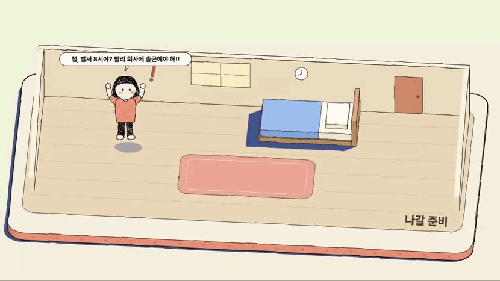

<details>
<summary><b>1. 어, 한번 열어 봤는데 3석 남는대!</b></summary>


<details>
<summary><b>고양이 쓰다듬기</b></summary>

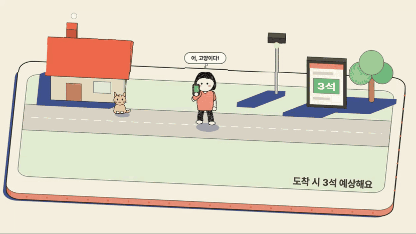

헐, 시간이 없어! 아래에서 다시 골라 보세요.

</details>

<details>
<summary><b>어, 내 정류장으로 가도 되겠다!</b></summary>


<details>
<summary><b>버스 온다! 오, 자리 있다!</b></summary>

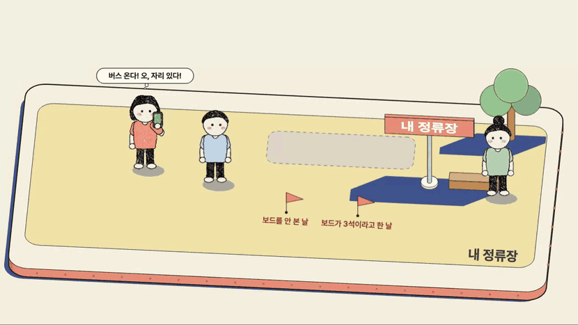

<details>
<summary><b>얼른 타자!</b></summary>


<details>
<summary><b>회사 앞이다, 내리자!</b></summary>

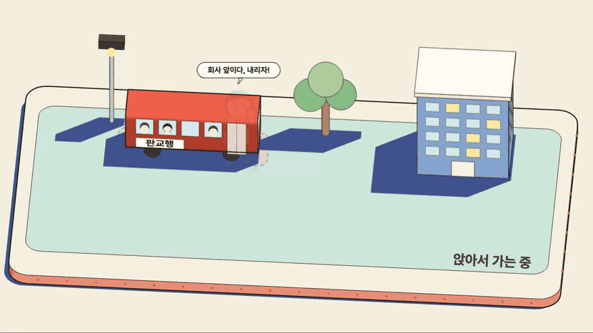

회사에 도착했습니다. 오늘 출근길은 여기까지입니다.

</details>

</details>

</details>

<details>
<summary><b>버스 온다! 헐, 만석이야...</b></summary>

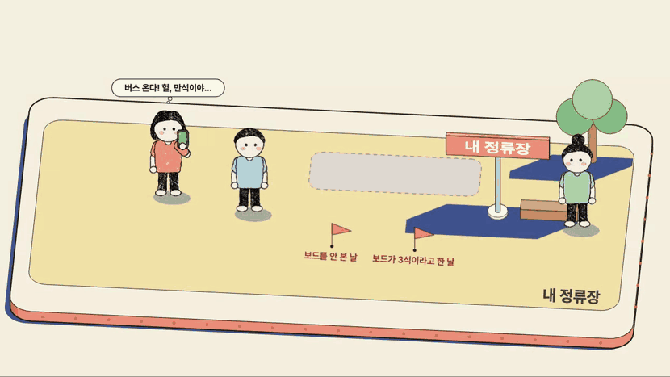

<details>
<summary><b>이건 보내고 다음 차를 보자. 오, 다음 차는 3석 남는대!</b></summary>


<details>
<summary><b>그럼 여기서 기다리자!</b></summary>

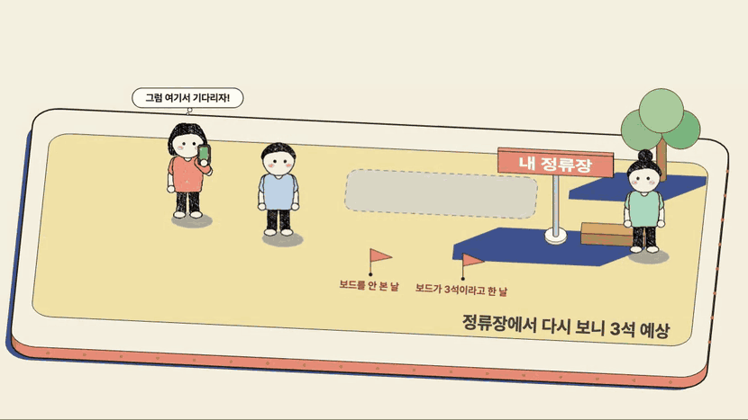

<details>
<summary><b>버스 온다! 오, 자리 있다!</b></summary>


<details>
<summary><b>얼른 타자!</b></summary>


<details>
<summary><b>회사 앞이다, 내리자!</b></summary>


회사에 도착했습니다. 오늘 출근길은 여기까지입니다.

</details>

</details>

</details>

<details>
<summary><b>버스 온다! 헐, 만석이야...</b></summary>


<details>
<summary><b>이건 보내고 앞 정류장으로 걸어가자!</b></summary>


<details>
<summary><b>여기는 자리 있다, 타자!</b></summary>

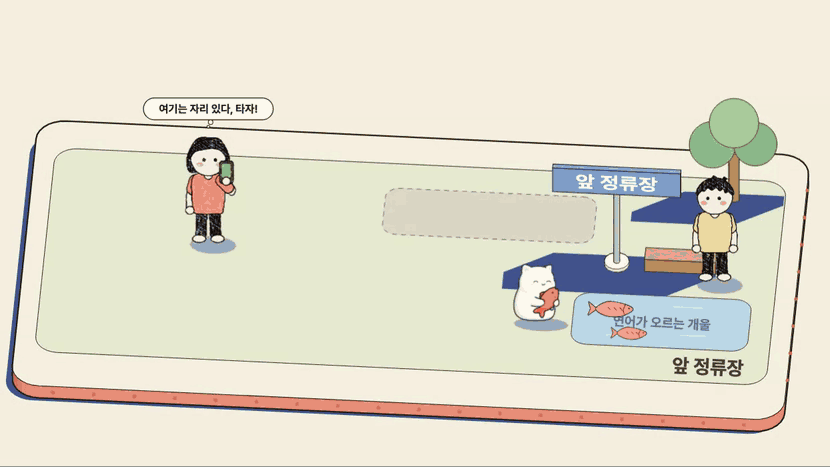

<details>
<summary><b>회사 앞이다, 내리자!</b></summary>


회사에 도착했습니다. 오늘 출근길은 여기까지입니다.

</details>

</details>

</details>

</details>

</details>

</details>

<details>
<summary><b>이건 보내고 다음 차를 보자. 헐, 다음 차도 자리가 없대...</b></summary>

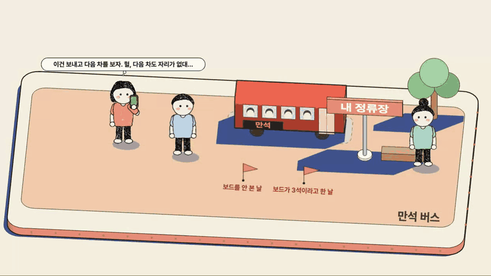

<details>
<summary><b>앞 정류장으로 옮겨서 타자!</b></summary>


<details>
<summary><b>여기는 자리 있다, 타자!</b></summary>

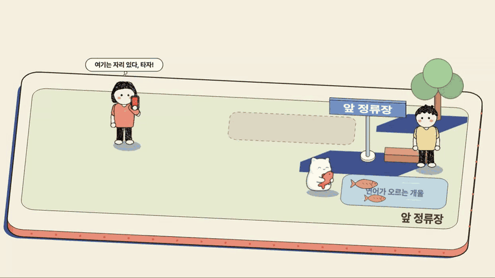

<details>
<summary><b>회사 앞이다, 내리자!</b></summary>

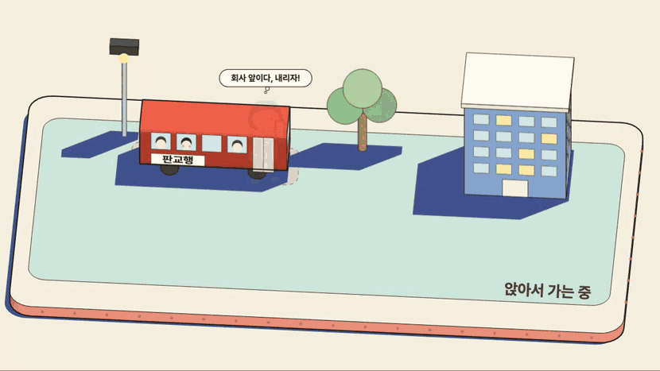

회사에 도착했습니다. 오늘 출근길은 여기까지입니다.

</details>

</details>

</details>

</details>

<details>
<summary><b>이건 보내고 앞 정류장으로 걸어가자!</b></summary>


<details>
<summary><b>여기는 자리 있다, 타자!</b></summary>


<details>
<summary><b>회사 앞이다, 내리자!</b></summary>


회사에 도착했습니다. 오늘 출근길은 여기까지입니다.

</details>

</details>

</details>

</details>

</details>

<br>

</details>

<details>
<summary><b>2. 어, 한번 열어 봤는데 자리가 없대...</b></summary>

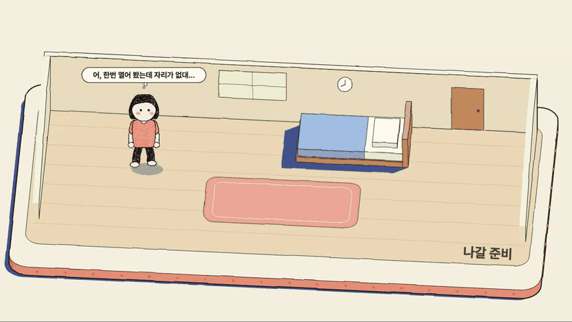

<details>
<summary><b>고양이 쓰다듬기</b></summary>


헐, 시간이 없어! 아래에서 다시 골라 보세요.

</details>

<details>
<summary><b>앞 정류장으로 옮겨서 타자!</b></summary>


<details>
<summary><b>여기는 자리 있다, 타자!</b></summary>


<details>
<summary><b>회사 앞이다, 내리자!</b></summary>


회사에 도착했습니다. 오늘 출근길은 여기까지입니다.

</details>

</details>

</details>

<details>
<summary><b>다음 차는 어떨까? 오, 다음 차는 3석 남는대!</b></summary>


<details>
<summary><b>고양이 쓰다듬기</b></summary>


헐, 시간이 없어! 아래에서 다시 골라 보세요.

</details>

<details>
<summary><b>어, 내 정류장으로 가도 되겠다!</b></summary>


<details>
<summary><b>버스 온다! 오, 자리 있다!</b></summary>


<details>
<summary><b>얼른 타자!</b></summary>


<details>
<summary><b>회사 앞이다, 내리자!</b></summary>


회사에 도착했습니다. 오늘 출근길은 여기까지입니다.

</details>

</details>

</details>

<details>
<summary><b>버스 온다! 헐, 만석이야...</b></summary>


<details>
<summary><b>이건 보내고 앞 정류장으로 걸어가자!</b></summary>


<details>
<summary><b>여기는 자리 있다, 타자!</b></summary>


<details>
<summary><b>회사 앞이다, 내리자!</b></summary>


회사에 도착했습니다. 오늘 출근길은 여기까지입니다.

</details>

</details>

</details>

</details>

</details>

</details>

<details>
<summary><b>다음 차는 어떨까? 헐, 다음 차도 자리가 없대...</b></summary>


<details>
<summary><b>고양이 쓰다듬기</b></summary>


헐, 시간이 없어! 아래에서 다시 골라 보세요.

</details>

<details>
<summary><b>앞 정류장으로 옮겨서 타자!</b></summary>


<details>
<summary><b>여기는 자리 있다, 타자!</b></summary>


<details>
<summary><b>회사 앞이다, 내리자!</b></summary>


회사에 도착했습니다. 오늘 출근길은 여기까지입니다.

</details>

</details>

</details>

</details>

<br>

</details>

<details>
<summary><b>3. 아, 못 믿겠어. 그냥 내 감으로 가 보자!</b></summary>

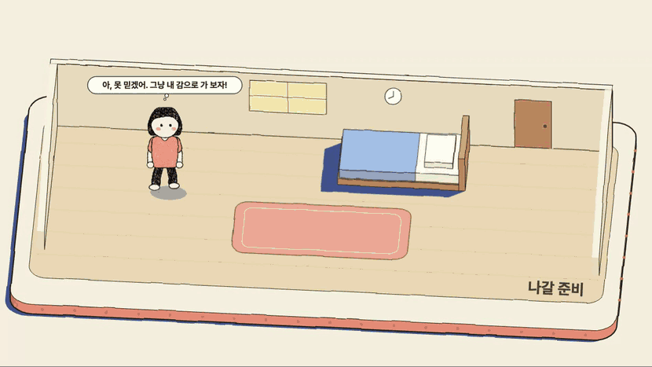

<details>
<summary><b>버스 온다! 오, 자리 있다!</b></summary>


<details>
<summary><b>얼른 타자!</b></summary>

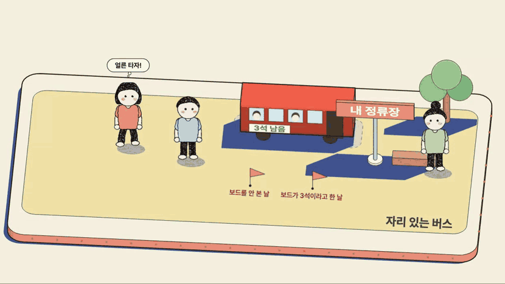

<details>
<summary><b>회사 앞이다, 내리자!</b></summary>


회사에 도착했습니다. 오늘 출근길은 여기까지입니다.

</details>

</details>

</details>

<details>
<summary><b>버스 온다! 헐, 만석이야...</b></summary>

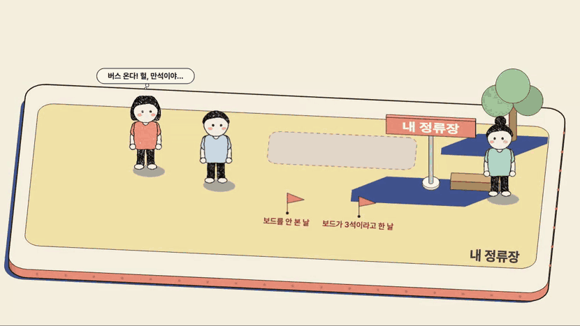

<details>
<summary><b>이건 보내고 다음 차를 보자. 오, 다음 차는 3석 남는대!</b></summary>


<details>
<summary><b>그럼 여기서 기다리자!</b></summary>


<details>
<summary><b>버스 온다! 오, 자리 있다!</b></summary>


<details>
<summary><b>얼른 타자!</b></summary>


<details>
<summary><b>회사 앞이다, 내리자!</b></summary>


회사에 도착했습니다. 오늘 출근길은 여기까지입니다.

</details>

</details>

</details>

<details>
<summary><b>버스 온다! 헐, 만석이야...</b></summary>


<details>
<summary><b>이건 보내고 앞 정류장으로 걸어가자!</b></summary>


<details>
<summary><b>여기는 자리 있다, 타자!</b></summary>


<details>
<summary><b>회사 앞이다, 내리자!</b></summary>


회사에 도착했습니다. 오늘 출근길은 여기까지입니다.

</details>

</details>

</details>

</details>

</details>

</details>

<details>
<summary><b>이건 보내고 다음 차를 보자. 헐, 다음 차도 자리가 없대...</b></summary>

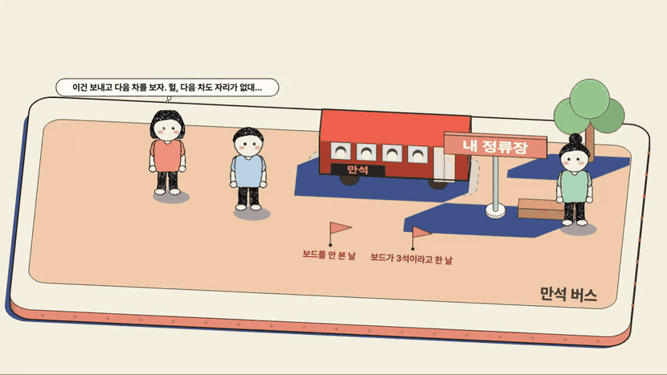

<details>
<summary><b>앞 정류장으로 옮겨서 타자!</b></summary>


<details>
<summary><b>여기는 자리 있다, 타자!</b></summary>


<details>
<summary><b>회사 앞이다, 내리자!</b></summary>


회사에 도착했습니다. 오늘 출근길은 여기까지입니다.

</details>

</details>

</details>

</details>

<details>
<summary><b>이건 보내고 앞 정류장으로 걸어가자!</b></summary>

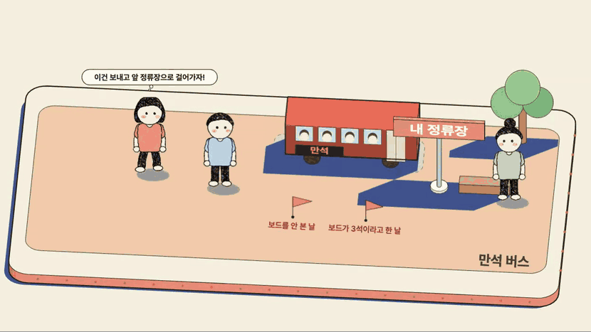

<details>
<summary><b>여기는 자리 있다, 타자!</b></summary>

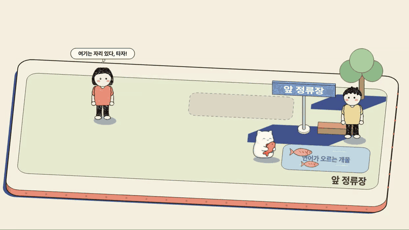

<details>
<summary><b>회사 앞이다, 내리자!</b></summary>


회사에 도착했습니다. 오늘 출근길은 여기까지입니다.

</details>

</details>

</details>

</details>

<br>

</details>

<br>
<br>

## 연어버스가 알려 주는 것

광역버스는 자리가 다 차면 정류장에서 기다리던 사람을 태우지 못하고 지나갑니다. 연어버스는 버스가 내 정류장에 도착할 때의 좌석을 예상해서, 집을 나서기 전에 탈 수 있는지 알려 줍니다. 화면에는 "도착 시 3석 예상해요", "도착 시 빈자리가 없어요"처럼 나옵니다.

<table>
<tr><td align="center">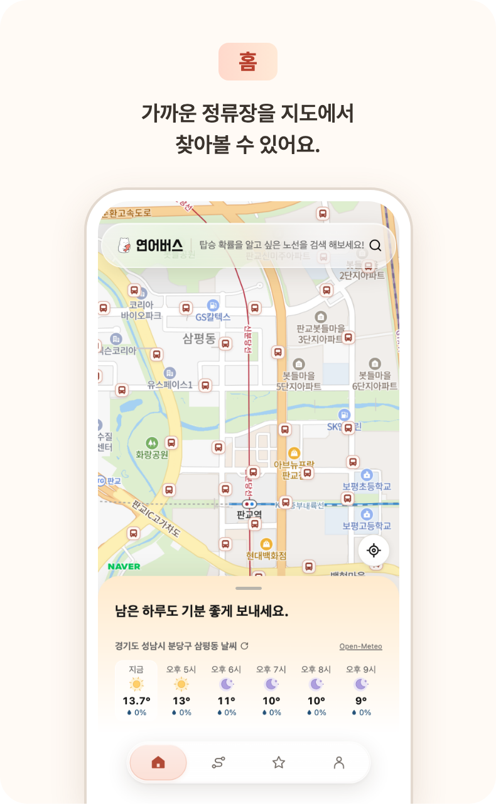</td><td align="center">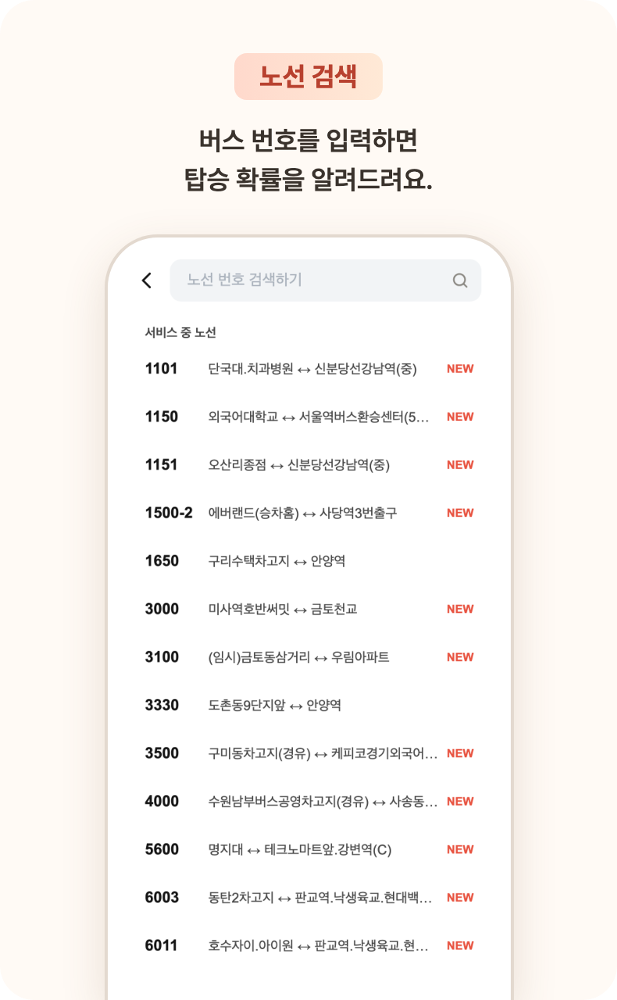</td></tr>
<tr><td align="center"><b>홈 화면</b></td><td align="center"><b>노선 검색</b></td></tr>
<tr><td align="center">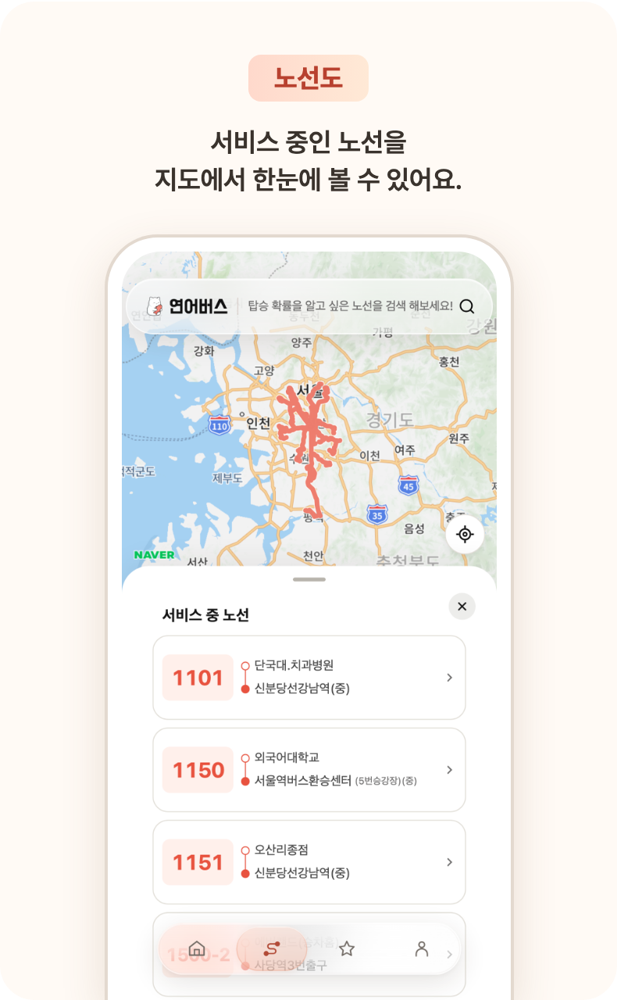</td><td align="center">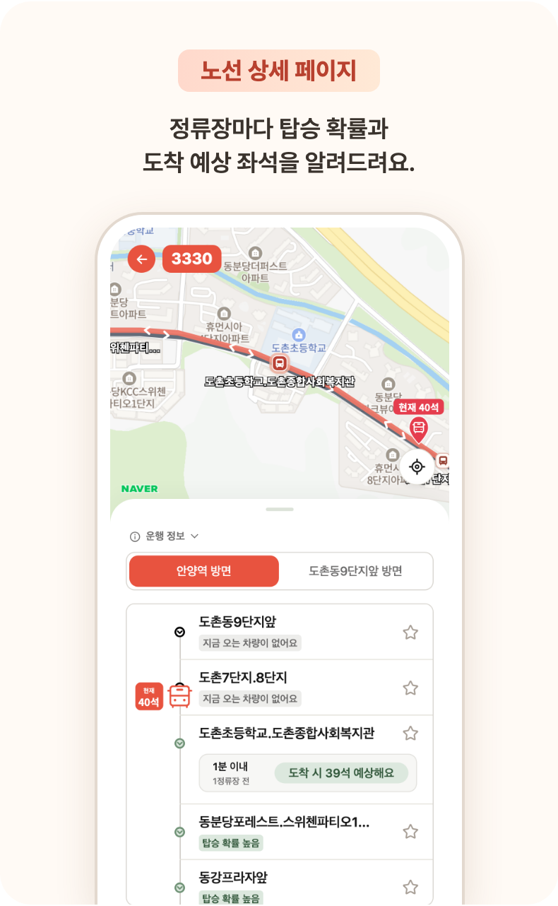</td></tr>
<tr><td align="center"><b>노선도</b></td><td align="center"><b>노선 상세 페이지</b></td></tr>
</table>

로그인하면 자주 타는 노선과 정류장을 즐겨찾기 그룹에 모아 둘 수 있습니다.

## 기술 스택

### Frontend & App (iOS)

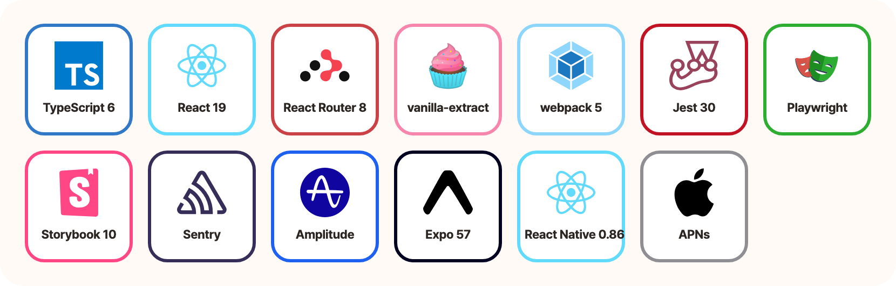

### Backend

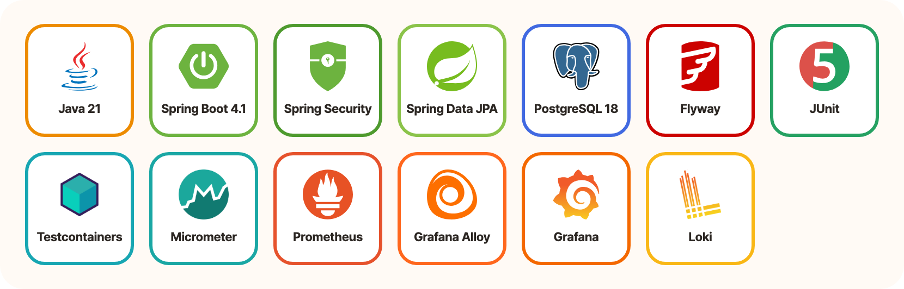

### Infrastructure & CI/CD

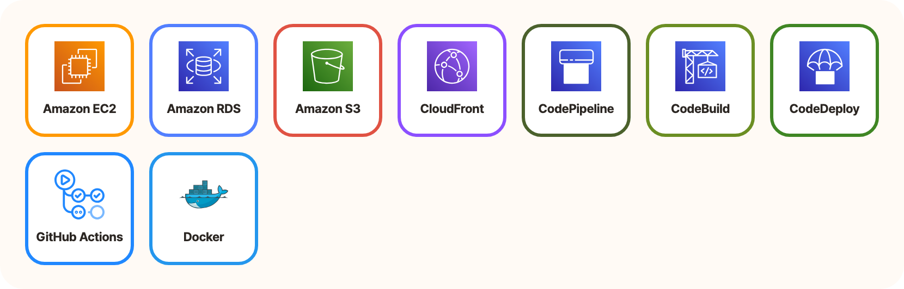

### Collaboration


<details>
<summary>기술 스택 전체 목록</summary>

**Frontend**

| 구분 | 기술 |
|---|---|
| 언어와 런타임 | TypeScript 6, Node.js 24, pnpm 11 |
| 화면 | React 19, React Router 8 |
| 스타일 | vanilla-extract |
| 빌드 | webpack 5, Babel 8 |
| 지도 | NAVER Maps JavaScript API |
| 테스트 | Jest 30, Playwright, Storybook 10 |
| 코드 검사 | ESLint 10, typescript-eslint, Prettier 3 |
| 모니터링 | Amplitude, Sentry |

- **React**와 **TypeScript**로 웹 화면을 만들고, **React Router**로 주소마다 화면을 나눕니다.
- 스타일은 **vanilla-extract**로 씁니다. 빌드할 때 CSS 파일로 바뀝니다.
- **webpack**과 Babel로 빌드합니다.
- **Jest**로 단위 테스트를, **Playwright**로 E2E 테스트를 돌립니다. 컴포넌트는 **Storybook**에서 따로 띄워 봅니다.
- 화면에서 난 오류는 **Sentry**로 모으고, 사용 흐름은 **Amplitude**로 봅니다.

**App (iOS)**

| 구분 | 기술 |
|---|---|
| 프레임워크 | Expo 57, React Native 0.86, TypeScript 6 |
| 웹 화면 | react-native-webview |
| 로그인 | Sign in with Apple, 카카오 로그인 SDK |
| 알림 | expo-notifications, APNs |
| 지도 | NAVER 지도 iOS SDK (Swift로 만든 Expo module) |
| 빌드 | EAS Build |

- **Expo**와 **React Native**로 iOS 앱을 만들고, WebView에서 웹 화면을 실행합니다.
- 알림은 **APNs**로 받습니다.

**Backend**

| 구분 | 기술 |
|---|---|
| 언어와 빌드 | Java 21, Gradle 9.5 |
| 프레임워크 | Spring Boot 4.1, Spring MVC, Spring Security |
| 로그인 | OAuth 2.0 (카카오, Apple), Spring Session JDBC |
| 데이터 | PostgreSQL 18, Spring Data JPA, Spring JDBC, Flyway |
| API 문서 | springdoc-openapi, OpenAPI 명세 |
| 외부 데이터 | 경기도 버스정보시스템(GBIS) API |
| 알림 | APNs |
| 테스트 | JUnit, AssertJ, Testcontainers, ArchUnit |
| 모니터링 | Micrometer, Prometheus, Grafana Alloy, Grafana, Loki |

- **Java 21**과 **Spring Boot**로 API 서버와 worker를 만듭니다. worker는 경기도 버스정보시스템(GBIS) API에서 버스 위치와 좌석을 수집하고 예보를 만듭니다.
- 데이터는 **PostgreSQL**에 저장하고 **Spring Data JPA**와 Spring JDBC로 읽고 씁니다. 스키마 변경은 **Flyway**로 관리합니다.
- 카카오와 Apple 로그인은 **Spring Security**의 OAuth 2.0으로 연결합니다.
- 테스트는 **JUnit**으로 쓰고, DB가 필요한 테스트는 **Testcontainers**로 PostgreSQL을 띄워 돌립니다.
- 서버 지표는 **Micrometer**가 **Prometheus** 형식으로 내보내고 **Grafana Alloy**가 모읍니다. 지표는 **Grafana**에서, 로그는 **Loki**에서 봅니다.

**Infrastructure & CI/CD**

| 구분 | 기술 |
|---|---|
| 서버 | AWS EC2, RDS, S3, CloudFront |
| 배포 | AWS CodePipeline, CodeBuild, CodeDeploy |
| CI | GitHub Actions |
| 로컬 개발 | Docker Compose |

- 웹 화면은 **Amazon S3**에 올리고 **CloudFront**로 내보냅니다.
- API 서버와 worker는 **Amazon EC2**에서 실행하고, DB는 **Amazon RDS**를 씁니다.
- 배포는 **AWS CodePipeline**, **CodeBuild**, **CodeDeploy**로 합니다. PR의 검사는 **GitHub Actions**가 돌립니다.
- 로컬 개발 환경은 **Docker** Compose로 띄웁니다.

**Collaboration**

| 구분 | 기술 |
|---|---|
| 티켓과 문서 | Jira, Confluence |

- 티켓은 **Jira**에서, 문서는 **Confluence**에서 관리합니다.

</details>

## 저장소 구성

| 폴더 | 내용 |
|---|---|
| [`frontend`](frontend) | 웹 화면입니다. |
| [`app`](app) | iOS 앱입니다. WebView에서 웹 화면을 실행합니다. |
| [`backend`](backend) | API 서버(`api-app`)와 worker(`worker-app`)입니다. worker는 GBIS에서 버스 위치와 좌석을 수집하고 예보를 만듭니다. |
| [`contract`](contract) | Frontend와 Backend가 함께 보는 API 명세(OpenAPI)입니다. |
| [`dev`](dev) | 로컬 실행 환경(Docker Compose)입니다. |
| [`docs`](docs) | 설계와 검증 기록입니다. |

## 로컬에서 실행하기

Docker Desktop이 있는 Apple Silicon 맥에서 저장소 루트의 명령 하나로 실행합니다.

```sh
./dev/local.sh up --watch
```

필요한 버전과 나머지 명령은 [로컬 실행 안내](dev/README.md)에 있습니다.

## 팀 구성원

| [<br>레스](https://github.com/lee-eojin) | [<br>루멘](https://github.com/bigcloud07) | [<br>코로구](https://github.com/korogoo) | [<br>동키](https://github.com/DongKey777) |
|:---:|:---:|:---:|:---:|
| Frontend | Frontend | Backend | Backend |
