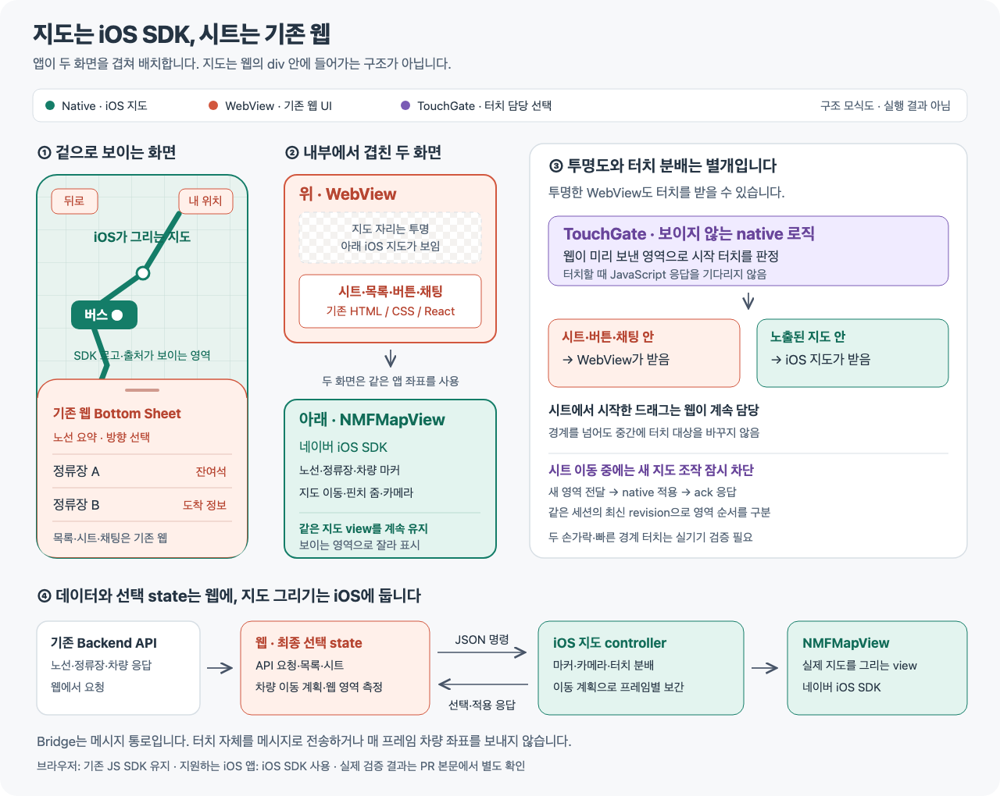
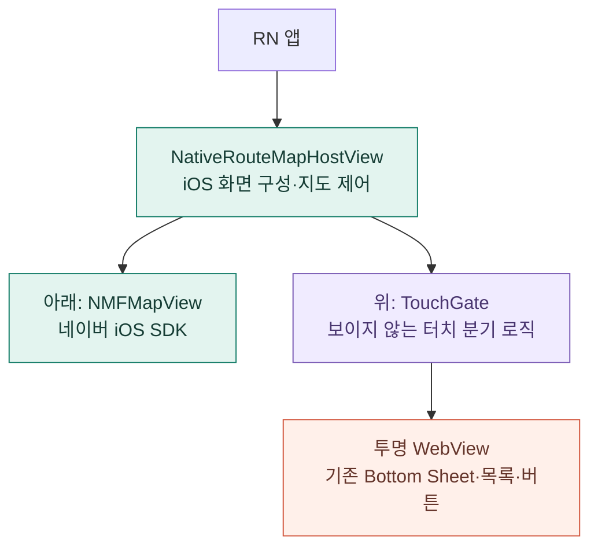
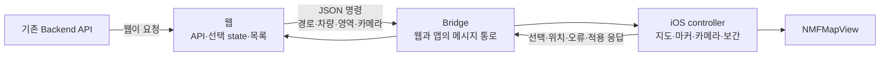
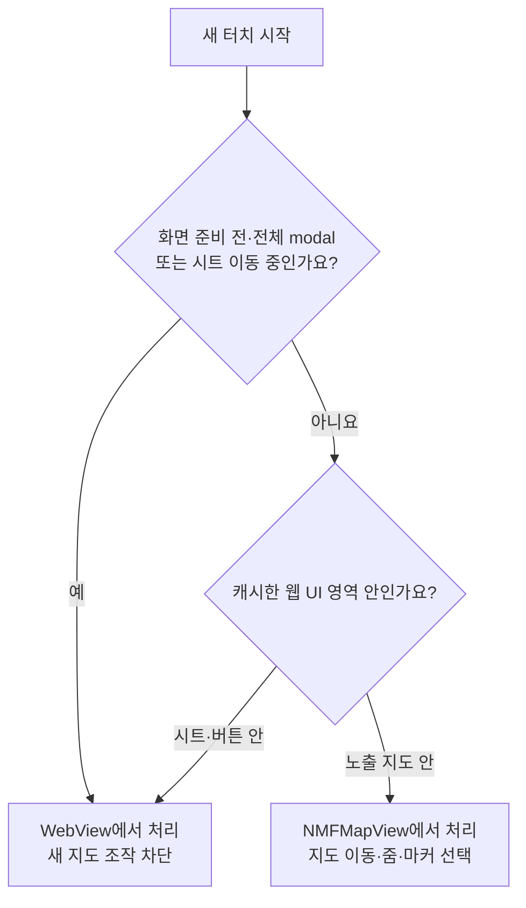
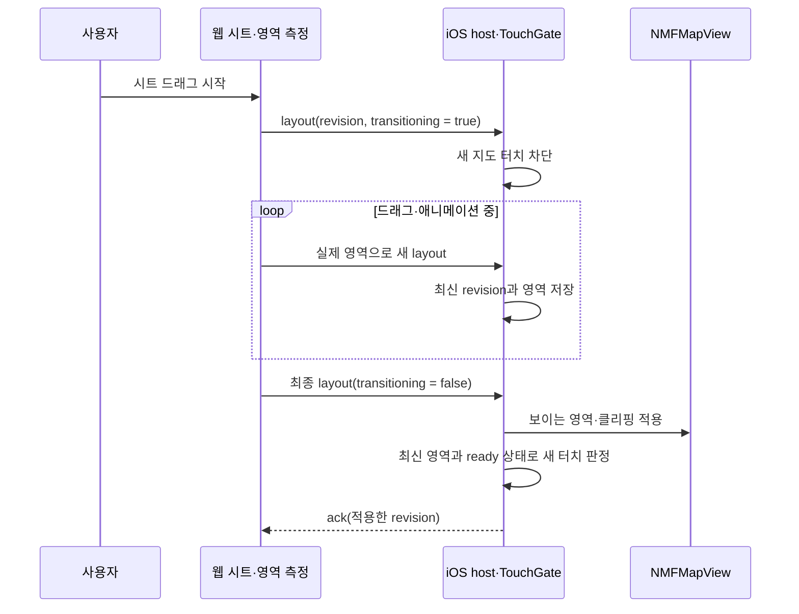
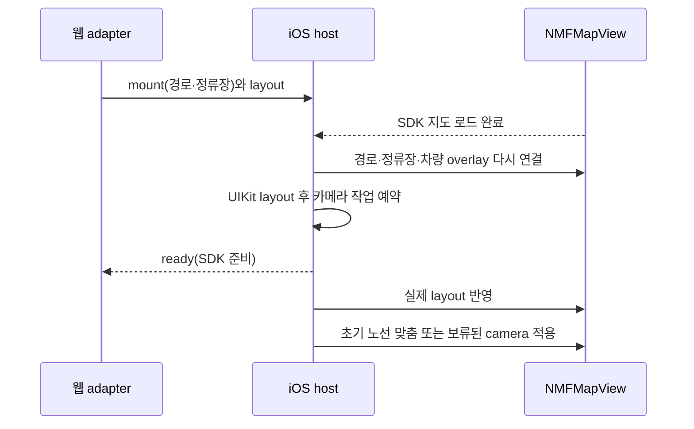
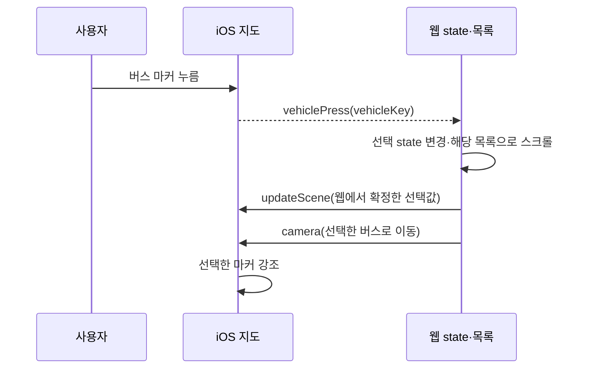
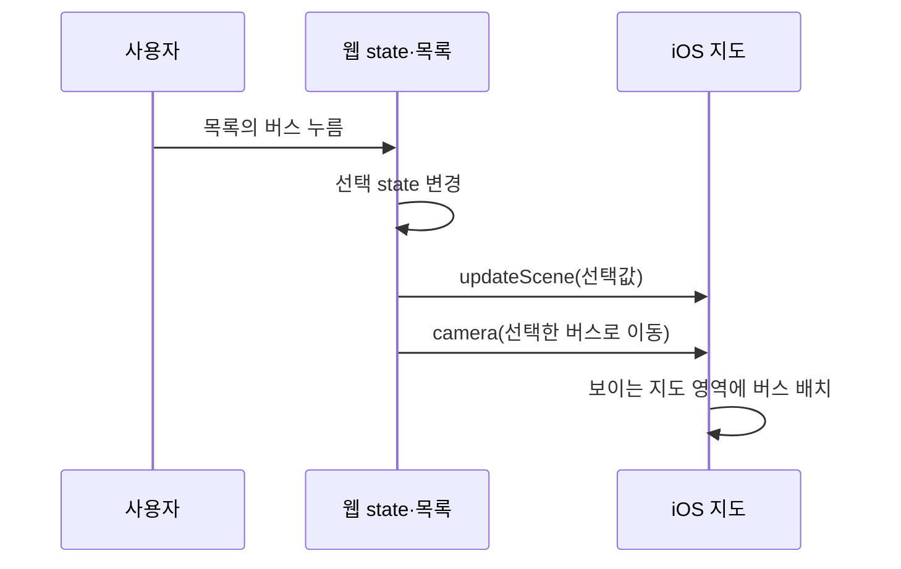
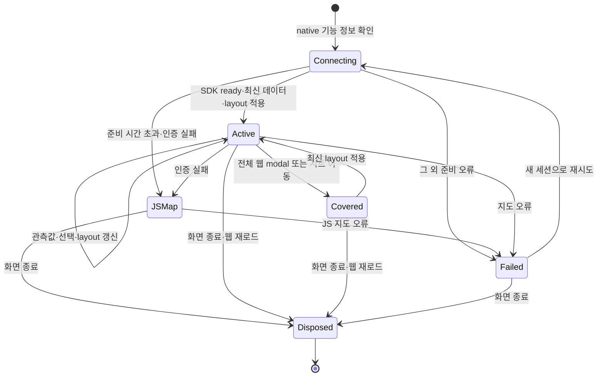

# iOS 지도 위에 기존 웹 Bottom Sheet를 겹치는 구조

앱에서는 **네이버 iOS SDK로 지도만 그리고, Bottom Sheet와 정류장 목록은 기존 웹으로 표시**합니다. 브라우저에서는 지금처럼 네이버 JavaScript SDK를 사용합니다.

이 문서는 처음 보는 분도 화면의 구성과 이벤트 흐름을 따라갈 수 있도록 정리했습니다. 아래 설계 그림과 HTML은 구조를 설명하는 모식도입니다. 실제 Simulator 캡처와 지도·제스처 확인 결과는 [검증 기록](./verification.md)에 별도로 정리했습니다. Simulator에서 확인한 범위와 iPhone 실기기에서 남은 범위도 구분합니다.

- [한 장으로 보는 구조](./overview.png) · [수정 가능한 SVG 원본](./overview.svg)
- [직접 조작해 보는 설명 HTML](./architecture.html): 파일을 내려받아 브라우저에서 열면 별도 서버나 외부 라이브러리 없이 동작합니다.
- [실제 Simulator 화면·제스처 로그·재현 방법](./verification.md)
- 관련 작업: [SAL-214](https://higgs95.atlassian.net/browse/SAL-214)



## 1. 사용자가 보는 화면은 하나, 실제로 그리는 화면은 둘입니다

`WebView`는 앱 안에서 웹 페이지를 보여 주는 native 컴포넌트입니다. 기존 앱은 WebView 안에서 지도와 목록을 모두 보여 줬습니다. 변경 후에는 iOS가 그리는 지도 위에 WebView를 겹칩니다.

```text
사용자가 보는 화면                 앱 내부의 두 화면
┌───────────────────────┐         ┌──────────────────────────┐
│ 뒤로       내 위치     │         │ 위: 투명한 WebView        │
│                       │         │   버튼·Bottom Sheet·목록  │
│      네이버 지도      │   ←     │   지도 자리는 투명        │
│       버스 ●          │         ├──────────────────────────┤
│ ┌───────────────────┐ │         │ 아래: NMFMapView          │
│ │ 기존 Bottom Sheet │ │         │   네이버 iOS SDK 지도     │
│ │ 정류장·잔여석·목록│ │         │   노선·정류장·버스 마커   │
│ └───────────────────┘ │         └──────────────────────────┘
└───────────────────────┘
```

Native 지도를 웹의 `<div>` 안에 넣는 구조는 아닙니다. 앱의 native host가 지도와 WebView를 함께 배치합니다. WebView 쪽 지도 자리만 투명하게 해서 아래 지도가 보이게 합니다. 시트 위치가 바뀌어도 같은 지도 view를 유지합니다.



## 2. 누가 무엇을 담당하나요?

웹에 이미 있는 데이터 흐름과 선택 state를 유지하고, 지도 표시와 제스처를 iOS로 옮깁니다. Native에 API 요청을 하나 더 만들지 않습니다.

| 항목 | 담당 | 경계를 이렇게 나눈 이유 |
| --- | --- | --- |
| 노선·정류장·차량 API 요청 | 웹 | 기존 polling과 데이터 처리를 이어서 사용합니다. |
| 선택한 방향·정류장·버스 | 웹 | 지도와 목록에서 선택해도 최종 state는 한곳에서 관리합니다. |
| Bottom Sheet·목록·버튼 UI | 웹 | 기존 화면과 동작을 유지합니다. |
| 노선·정류장·버스 마커 | iOS | `NMFMapView`와 native overlay로 그립니다. |
| 지도 드래그·핀치 줌·카메라 | iOS | 실제 지도 view가 native 제스처를 받습니다. |
| 현재 위치 권한과 조회 | iOS | 위치 버튼은 웹에 두고, 필요한 동작을 메시지로 요청합니다. |
| 차량의 이동 경로와 이동 시간 | 웹 | 목록과 지도에 사용할 같은 이동 계획을 만듭니다. |
| 차량의 매 프레임 중간 좌표 | iOS | `CADisplayLink`에서 보간하여 WebView 메시지를 매 프레임 보내지 않습니다. |
| 터치할 수 있는 웹 영역의 측정 | 웹 | DOM에서 실제 시트와 버튼의 위치를 알 수 있습니다. |
| 시작 터치의 대상 선택 | iOS TouchGate | 미리 저장한 영역으로 동기적으로 판정합니다. |



Bridge는 화면을 그리거나 터치를 전달하는 장치가 아닙니다. 웹과 앱 사이에서 데이터와 명령을 주고받는 통로입니다. 터치 자체는 UIKit이 native view에 전달합니다.

## 3. 투명한 것과 터치가 통과하는 것은 다릅니다

투명한 WebView도 터치를 받을 수 있습니다. CSS 배경을 지우거나 `pointer-events`를 설정하는 것만으로 아래 native 지도가 제스처를 받는 구조가 완성되지는 않습니다.

TouchGate는 웹에서 받은 영역을 native에 저장해 둡니다. 새 터치가 시작되면 이 좌표를 보고 WebView와 지도 중 어느 쪽을 대상으로 삼을지 정합니다. 터치할 때 JavaScript 응답을 기다리지 않습니다.



시트 전체를 웹 영역으로 등록하므로 시트의 빈 여백도 웹이 받습니다. 목록 행이나 버튼만 등록하면 시트의 빈 곳을 드래그할 때 뒤 지도가 움직일 수 있습니다. `document.body`에 별도로 렌더되는 UI도 같은 측정 대상에 포함합니다.

한 손가락의 터치 대상은 시작할 때 정합니다. 시트에서 시작한 드래그가 지도 영역으로 넘어갔다고 중간에 native 지도로 다시 보내지 않습니다. 지도에서 시작한 드래그도 같은 원칙을 따릅니다. 다만 **두 번째 손가락, 시트 경계에서 시작하는 핀치, UIKit gesture recognizer 간 상호작용은 별도 실기기 검증이 필요**합니다. `hitTest` 구현만으로 모든 multi-touch 조합이 검증됐다고 볼 수는 없습니다.

## 4. 시트가 움직일 때는 실제 화면 영역을 전달합니다

`half` 같은 단계 이름만으로는 드래그·애니메이션 중인 시트의 실제 위치를 알 수 없습니다. 웹은 `getBoundingClientRect()`로 지도와 `[data-native-map-hit]` 요소를 측정하고, `ResizeObserver`와 애니메이션 중 측정을 통해 새 layout을 보냅니다.



`revision`은 메시지의 최신 순서를 구분하는 번호이며, `ack`는 native가 layout을 적용했다는 응답입니다. 현재 웹 adapter는 `ack`를 기다려 터치를 해제하지 않습니다. Native host가 최신 layout을 적용하는 자리에서 지도 준비 상태와 함께 판정합니다. 이 두 장치가 Bridge 전달 지연 자체를 없애지는 않습니다. 최초 드래그 신호가 native에 도착하기 전의 짧은 구간도 있어 빠른 경계 터치는 실기기에서 확인해야 합니다.

CSS 좌표와 iOS view 좌표를 연결할 때는 웹 viewport와 native host의 크기·원점을 함께 사용합니다. `devicePixelRatio`를 단순히 곱하는 방식은 사용하지 않습니다. Safe area, 키보드, `visualViewport`, 화면 크기 변경도 같은 좌표 계약으로 다뤄야 합니다.

현재 구현은 지도 콘텐츠 inset 대신 **큰 지도 view를 잘라 보여 주는 방식**을 사용합니다. `NMFMapView`는 최소 native host 높이로 유지하고, `mapContainer`가 웹의 실제 `mapRect`에 맞춰 가운데 부분을 잘라 보여 줍니다. 시트 드래그마다 지도 view를 새로 생성하지 않습니다. 초기 경로 맞춤은 잘린 부분을 고려한 camera padding을 사용하고, 목록에서 대상을 선택하면 보이는 영역의 중앙으로 카메라를 이동합니다. SDK 로고는 `logoMargin`으로 노출 영역 하단에 둡니다.

초기 카메라 맞춤은 **SDK 준비와 UIKit의 실제 layout이 끝난 뒤**로 미룹니다. Scene이 SDK renderer보다 먼저 준비될 수 있어, SDK 로드 완료 시 경로·정류장·차량 overlay를 지도에 다시 연결합니다. 이후 main queue에서 지도 layout을 반영한 다음 초기 노선 맞춤이나 보류 중인 카메라 명령을 적용합니다. `ready` 이벤트 자체는 SDK 준비 알림이며, 초기 카메라 맞춤 완료를 뜻하지는 않습니다.



## 5. 지도와 목록의 선택은 이렇게 연결합니다

### 지도에서 버스를 누른 경우



### 목록에서 버스를 누른 경우



Native는 선택 이벤트를 웹에 알리고, 웹에서 확정한 선택값을 다시 표시합니다. 기존 웹과 마찬가지로 지도 마커에서 선택한 경우에도 카메라 이동 명령은 이어집니다. `focusMarker: false`는 웹의 DOM focus를 생략하는 구분이며 카메라 이동을 생략한다는 뜻은 아닙니다. 카메라의 현재 위치와 같은 지도 내부 상태는 native에 남깁니다.

## 6. 차량 애니메이션은 매 프레임 메시지를 보내지 않습니다

웹은 새로운 관측값으로 차량의 이동 계획을 만듭니다. 이 계획에는 경로 위의 keyframe 좌표와 진행률, 이동 시간이 들어갑니다. iOS는 계획을 받아 `CADisplayLink`로 중간 위치를 계산합니다.

```text
기존 API 응답       웹에서 이동 계획 생성        iOS에서 매 프레임 처리
    │                    │                            │
    └──────────────────→ │                            │
                         └─ motion(경로·진행률·시간) ─→│
                                                      ├─ 좌표 보간
                                                      ├─ 마커 이동
                                                      └─ 다음 프레임 반복
```

새 관측값이 오면 새 계획으로 갱신합니다. 웹 목록과 native 지도가 같은 입력을 사용하더라도 서로 다른 렌더링 루프의 타이밍이 완전히 일치한다고 단정하지 않습니다. 백그라운드 복귀, 중단된 애니메이션, 다음 관측값 수신 시 이어지는 위치는 실제 실행으로 확인할 항목입니다.

## 7. 앱을 구분하고, 오래된 메시지를 버립니다

Native 지도는 User-Agent로 판단하지 않습니다. 앱이 페이지 로드 전에 다음 기능 정보를 주입한 경우에만 선택합니다.

```ts
window.SalmonNativeMap = {
  version: 1,
  platform: 'ios',
  postMessage: (message: string) => { /* 앱으로 전달 */ },
};
```

기능 정보가 없는 브라우저는 기존 JS SDK를 사용합니다. 앱에서 native 지도 준비가 15초 안에 끝나지 않거나 인증이 실패하면 native 지도를 정리하고 기존 JS 지도로 전환합니다. 같은 화면에서는 JS 지도를 유지하며, 늦게 도착한 native 이벤트로 다시 전환하지 않습니다. 선택 state와 차량 이동도 JS 지도에 연결하고, JS 지도까지 실패하면 오류 안내와 정류장 목록을 유지합니다. 그 외 native 오류는 기존 오류 안내를 표시합니다.

전환 원인은 기존 Sentry에 `source:native-map`, `failure_kind:timeout` 또는 `failure_kind:auth`로 기록합니다. 노선 ID를 함께 기록하며 좌표나 원본 native 오류 메시지는 보내지 않습니다. 수집은 기존 production 설정을 따르고, 같은 오류의 반복 전송은 기존 1분 제한을 적용하므로 이벤트 수가 전체 실패 횟수와 같지는 않습니다. Native 준비 대기 뒤 JS SDK 로딩 시간이 추가될 수 있습니다.

이번 구현은 iOS용입니다. Android나 native module이 없는 실행 환경에서는 이 기능 정보를 주입하지 않으므로 기존 WebView의 JS 지도 경로를 사용합니다.

메시지의 공통 형식은 다음과 같습니다. 실제 타입의 기준은 [`protocol.ts`](../../frontend/src/shared/native-map/protocol.ts)입니다.

```ts
{ v: 1, sessionId, revision, type, payload }
```

| 방향 | 명령 또는 이벤트 | 의미 |
| --- | --- | --- |
| 웹 → 앱 | `mount` | 새 세션을 열고 노선·정류장·경로를 전달합니다. |
| 웹 → 앱 | `updateScene` | 방향·차량·선택 표시를 갱신합니다. |
| 웹 → 앱 | `motion` | 차량 이동 계획을 전달합니다. |
| 웹 → 앱 | `layout` | 실제 화면 영역과 터치 영역을 전달합니다. |
| 웹 → 앱 | `camera` | 대상 위치로 지도 카메라를 이동합니다. |
| 웹 → 앱 | `location` | 현재 위치 권한·조회를 요청합니다. |
| 웹 → 앱 | `unmount` | 현재 지도 세션을 종료합니다. |
| 앱 → 웹 | `ready`, `ack` | 지도 준비와 layout 적용 결과를 알립니다. |
| 앱 → 웹 | `stopPress`, `vehiclePress` | 지도에서 누른 대상을 알립니다. |
| 앱 → 웹 | `mapPress` | 지도 빈 영역 클릭에 따라 웹의 선택을 해제합니다. |
| 앱 → 웹 | `locationResult`, `error` | 위치 결과나 오류를 알립니다. |

노선 전환·재시도·WebView 재로드는 기존 세션을 정리하는 경계입니다. 새 세션을 열고 현재 snapshot을 다시 전달합니다. 이전 `sessionId`의 늦은 응답이나 마커 이벤트를 새 화면에 적용하지 않습니다. `revision`은 같은 세션 안의 명령 순서를 관리합니다.



상태도는 책임을 설명하기 위한 개념도입니다. 상태 이름은 코드의 enum 이름을 뜻하지 않습니다. 전체 modal 뒤 지도의 터치와 접근성 노출을 함께 막는지, WebView content process가 종료될 때 기존 native 세션이 정리되는지도 확인해야 합니다.

## 코드를 읽는 순서

| 순서 | 파일·영역 | 확인할 내용 |
| --- | --- | --- |
| 1 | [`app/App.tsx`](../../app/App.tsx) | 기능 정보 주입, native host와 WebView 연결, 웹 재로드 경계 |
| 2 | [`protocol.ts`](../../frontend/src/shared/native-map/protocol.ts) | 웹과 앱이 주고받는 타입·버전·검증 규칙 |
| 3 | [`RouteMap.tsx`](../../frontend/src/pages/verdict-board/map/RouteMap.tsx) | JS SDK 로드 전 실행 환경 분기와 기존 지도 호출부 |
| 4 | [`NativeRouteMapHostView.swift`](../../app/modules/salmon-native-map/ios/NativeRouteMapHostView.swift) | `NMFMapView`, `WebOverlayGate`의 hitTest, 명령 적용과 차량 보간 |
| 5 | [`nativeMapAdapter.ts`](../../frontend/src/pages/verdict-board/map/nativeMapAdapter.ts) · [`overlayLayoutBridge.ts`](../../frontend/src/shared/native-map/overlayLayoutBridge.ts) | 기존 선택 흐름을 native 메시지로 연결하는 부분과 DOM 영역 수집 |
| 6 | [`withSceneLifecycle.js`](../../app/plugins/withSceneLifecycle.js) | iOS scene 설정과 Expo의 앱 창·React Native 시작 경로 |
| 7 | [`NativeMapInteractionTests.swift`](../../app/verification/NativeMapInteractionTests.swift) · [`setup-ui-tests.rb`](../../app/verification/setup-ui-tests.rb) | 실제 native 지도·웹 시트 XCUITest와 생성 프로젝트에 검증 target을 연결하는 방법 |

## iOS에서 실행할 때 필요한 설정

네이버 클라우드의 Dynamic Map 설정에 앱 Bundle ID인 `com.salmonbus.app`을 등록하고, 발급받은 공개 key ID를 `app/.env`의 `NAVER_MAP_KEY_ID`에 넣습니다. 서버용 client secret을 넣는 항목은 아닙니다. 웹 주소는 기존 `EXPO_PUBLIC_WEB_URL`을 사용합니다.

[`app.config.ts`](../../app/app.config.ts)가 이 값을 iOS의 `NMFNcpKeyId`에 반영하고, 위치 조회 안내 문구를 함께 설정합니다. 키를 바꾸면 해당 native 설정을 포함하도록 앱을 다시 빌드해야 합니다. 앱 의존성을 설치한 뒤 `app` 디렉터리에서 `pnpm ios`로 development build를 실행할 수 있습니다.

앱의 [`withSceneLifecycle.js`](../../app/plugins/withSceneLifecycle.js) config plugin은 iOS scene manifest에 Expo의 `ExpoAppSceneDelegate`를 등록합니다. AppDelegate는 React Native factory를 준비하고, 실제 window 생성과 React Native 시작은 Scene Delegate가 맡습니다. 기존 시작 코드를 함께 남겨 두어 React Native root를 두 번 만드는 상황을 피하도록 prebuild 단계에서 템플릿을 변환합니다. Expo 템플릿이 달라져 변환 위치를 찾지 못하면 명시적으로 실패하므로, Expo 업데이트 시 이 plugin과 테스트도 확인해야 합니다.

Native 설정과 plugin을 반영할 때는 `app` 디렉터리에서 `pnpm exec expo prebuild --platform ios`를 실행한 뒤 다시 빌드합니다. 실행 순서와 환경 변수는 [`app/README.md`](../../app/README.md)에도 정리했습니다.

Expo Go에는 이 local native module이 포함되지 않습니다. Native SDK와 module을 포함한 iOS development build를 사용해야 합니다. 올바른 키와 Bundle ID가 준비됐는지, 실제 SDK 타일을 불러오는지는 빌드 및 실행 검증으로 확인합니다.

## 검증 범위

정적 분석과 단위 테스트는 메시지·좌표·기존 웹 로직의 일부 오류를 확인합니다. 실제 UIKit 터치와 지도 SDK 실행은 iOS 빌드 및 기기 검증이 별도로 필요합니다. **이 문서의 모식도와 인터랙티브 HTML은 테스트 결과가 아닙니다.** 실행한 자동 검증의 수치와 재현 방법은 [검증 기록](./verification.md)에 모았습니다.

Xcode 27.1에서 NMapsMap 3.24.0을 포함한 Simulator 빌드와 실제 앱 실행을 확인했습니다. iPhone 17 / iOS 27.0 Simulator에서는 SDK 인증·실제 지도 타일·검증용 노선과 24개 정류장·활성 상행 차량 2개를 확인했습니다. iPhone Duo / iOS 27.1 Simulator의 최종 제스처 확인 빌드에서는 지도 double-tap 확대(`11.01 → 12.01`), 웹 시트 드래그, 웹 버스 목록 선택 후 native 카메라 이동을 확인했습니다.

실제 native 지도와 웹 시트를 대상으로 한 XCUITest도 **1개 / 실패 0개, 20.106초**로 통과했습니다. 지도 pan은 SDK의 `gestureMoves` 증가, 웹 시트 드래그는 지도 노출 높이 변화와 `gestureMoves` 유지, double-tap은 SDK zoom 증가로 확인합니다. [검증 기록](./verification.md)에 테스트 원본과 생성 프로젝트에 검증 target을 연결하는 스크립트, 재실행 명령을 정리했습니다. 이 결과는 Simulator에서 수행한 해당 시나리오에 대한 확인이며, 모든 multi-touch 조합이나 실제 운행 정보 검증을 뜻하지 않습니다.

| 환경 | 확인할 동작 |
| --- | --- |
| 자동 검증 | protocol parsing, 세션·revision 거부, 경로·motion 계획, native adapter의 명령과 이벤트, 기존 웹 테스트·typecheck·lint |
| iOS Simulator | native module 등록·실제 `NMFMapView` 생성, 인증 설정, 경로와 마커, layout·카메라 연결, 재로드·종료 |
| iPhone 실기기 | 지도 이동·핀치, 시트 드래그·목록 스크롤, 경계 터치·두 번째 손가락, 빠른 시트 전환 |
| 위치·복구 | 위치 허용·거부, 지도 인증·네트워크 실패, 앱 백그라운드 복귀, 노선 전환 중 늦은 이벤트 |
| 가림·접근성 | 키보드와 modal, Safe area·화면 크기 변경, VoiceOver에서 뒤 지도 노출 차단, SDK 로고·출처 가림 |
| 성능 | 실제 차량 수에서 마커 이동·카메라 조작, 웹과 native의 시각적 위치 차이, 불필요한 Bridge 메시지 여부 |

## 기술 문서

- [네이버 iOS SDK 시작하기](https://navermaps.github.io/ios-map-sdk/guide-ko/1.html)
- [NMFMapView API](https://navermaps.github.io/ios-map-sdk/reference/Classes/NMFMapView.html)
- [UIKit `hitTest(_:with:)`](https://developer.apple.com/documentation/uikit/uiview/hittest(_:with:))
- [Expo local modules](https://docs.expo.dev/modules/get-started/)
