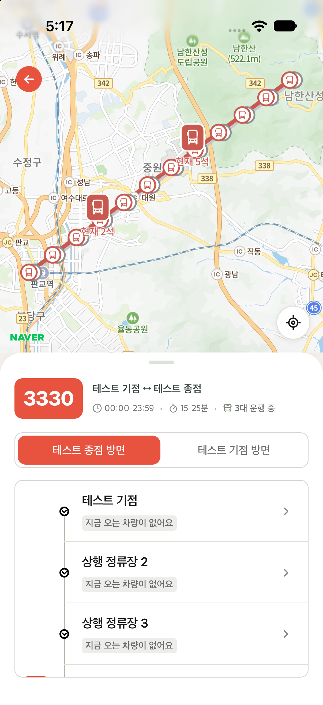
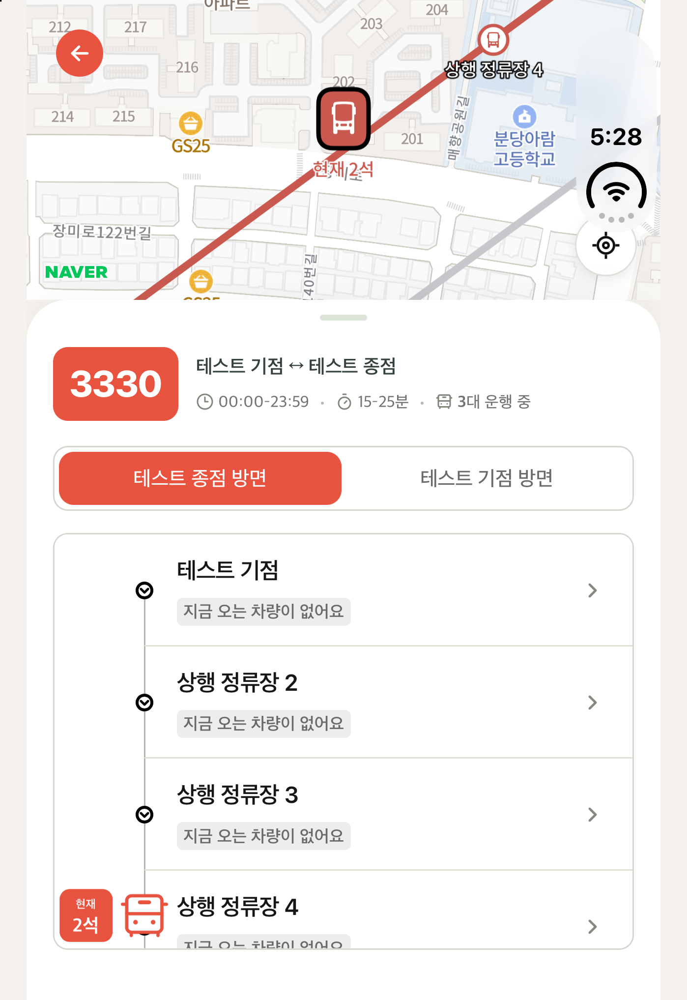
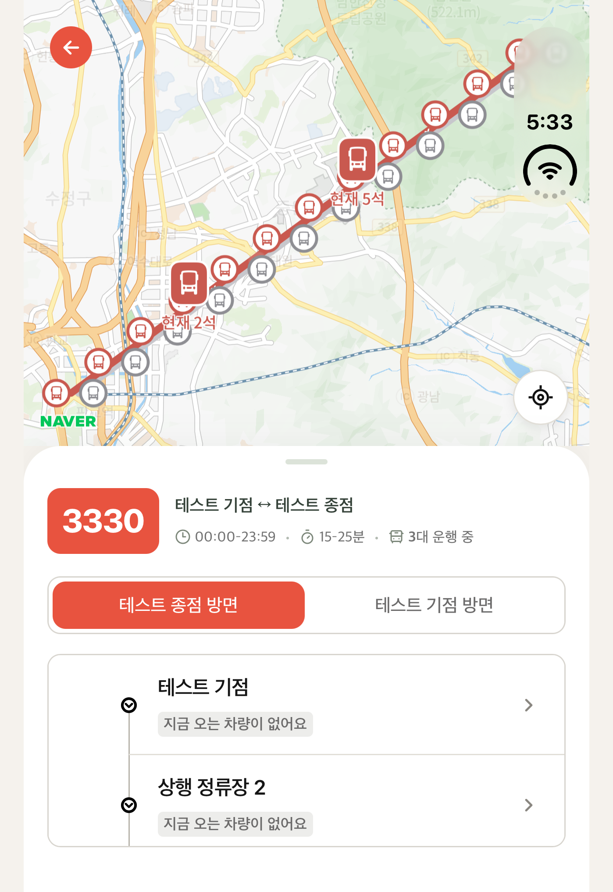
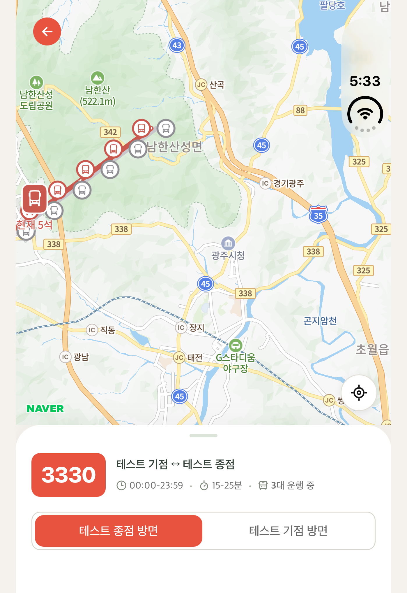

# Native 지도 검증 기록

## 검증 환경

- Xcode 27.1, Apple Silicon, Expo 57.0.27, React Native 0.86.3
- 네이버 iOS SDK `NMapsMap 3.24.0`, `react-native-webview 13.16.1`
- iPhone 17 / iOS 27.0 Simulator에서 SDK 인증·지도 표시 확인
- iPhone Duo / iOS 27.1 Simulator에서 최종 제스처 확인 빌드 실행
- 실제 네이버 SDK 인증과 지도 타일을 사용하고, 노선·정류장·차량 응답은 기존 E2E의 검증용 데이터를 사용
- 검증용 노선은 `200000001`, 정류장 24개, 상행 차량 2개와 하행 차량 1개이며 실제 운행 정보가 아님
- 공식 NMapsMap XCFramework에 `ios-arm64_x86_64-simulator` slice가 포함된 것도 직접 확인

## 자동 검증

| 범위 | 결과 |
| --- | --- |
| Frontend TypeScript·ESLint | 통과 |
| Frontend 단위 테스트 | 41 suites / 469개 통과 |
| Chromium·WebKit 지도·채팅·native 연결 E2E | 최초 186개 중 185개 통과. 기존 Chromium 채팅 1024px 로딩 1건 실패 |
| 실패한 채팅 사례와 native 연결 사례 재검증 | 두 엔진에서 12개 모두 통과 |
| 로딩 중 터치 차단 보완 후 native 연결 E2E | 두 엔진에서 10개 모두 통과 |
| Frontend production build | 통과. 기존 asset·entrypoint 크기 경고 2개 |
| App TypeScript·ESLint | 통과 |
| Expo Scene lifecycle 회귀 | 3개 통과 |
| Simulator compile·link | 전체 workspace 및 최종 native/app target 빌드 통과 |
| 실제 native 지도 XCUITest | `testNativePanWebSheetAndDoubleTap` 1개 / 실패 0개, 20.106초 |

브라우저 E2E의 native host 대역은 메시지·웹 레이아웃을 검사한다. 실제 UIKit 터치와 SDK 렌더링은 아래 Simulator 확인과 구분한다. 위 E2E 숫자는 여러 실행의 결과이며, 한 번의 전체 실행에서 모두 통과했다고 합산하지 않았다.

## Simulator 직접 확인

- [x] Expo 공식 Scene Delegate로 시작하고 Metro 및 기존 WebView가 로드된다.
- [x] 네이버 iOS SDK 인증 후 실제 지도 타일이 표시된다.
- [x] 처음 진입하면 검증용 노선이 보이는 영역에 맞춰지고 경로·정류장·차량 마커가 표시된다.
- [x] 지도 시작 터치는 native TouchGate에서 `map`으로 분류된다.
- [x] 웹 시트 시작 터치는 `web`으로 분류되고 시트가 펼쳐진다.
- [x] 웹 목록의 버스를 선택하면 native 카메라가 해당 버스로 이동하고 확대된다.
- [x] 최종 제스처 확인 빌드에서 지도 double-tap 시 native 카메라 확대와 `reason=gesture`를 확인한다.
- [x] 시트 `half → expanded` 드래그 구간에는 `target=web`만 기록되고 native 카메라의 gesture 변화가 기록되지 않는다.
- [x] XCUITest에서 실제 native 지도 pan, 웹 시트 드래그, native double-tap zoom을 연속 검증한다. 1개 사례 / 실패 0개로 통과했다.

| iPhone 17 / iOS 27.0 | iPhone Duo / iOS 27.1, 첫 번째 디스플레이 |
| --- | --- |
|  |  |

위 화면은 실제 Simulator 캡처다. 왼쪽은 처음 노선을 연 화면이고, 오른쪽은 시트를 펼치고 웹 목록의 버스를 선택한 화면이다. Duo는 `--display=1`로 첫 번째 디스플레이를 캡처했다. 네이버 지도 타일과 인증은 실제 SDK를 사용하며, 노선·정류장·차량은 검증용 데이터다. 기본 상행 선택에서 지도에는 정류장 마커 24개와 활성 상행 차량 마커 2개가 연결된 것을 DEBUG 로그로 함께 확인했다.

### 최종 제스처 확인 빌드의 기록

iPhone Duo / iOS 27.1 Simulator에서 다음 순서로 조작했다. 아래는 키와 정확한 좌표가 포함되지 않은 DEBUG 로그의 관련 부분이다.

| 조작 | 확인한 결과 |
| --- | --- |
| 노출된 지도를 double-tap | `target=map`, 카메라 zoom `11.01 → 12.01`, `moved=true`, `reason=gesture` |
| 웹 시트를 `half → expanded`로 드래그 | `target=web`, 해당 구간에 native 카메라 `reason=gesture` 기록 없음 |
| 웹 목록의 버스를 클릭 | `target=web` 뒤에 `reason=programmatic`, zoom `16.00`, `moved=true` |

```text
# 지도 double-tap
[SalmonNativeMap] hit target=map
[SalmonNativeMap] camera willChange reason=gesture animated=true
[SalmonNativeMap] camera idle zoom=12.01 moved=true reason=gesture routeCenter=inside stops=24 vehicles=2

# 웹 시트 드래그 구간
[SalmonNativeMap] hit target=web
[SalmonNativeMap] hit target=web

# 웹 목록에서 버스 선택
[SalmonNativeMap] hit target=web
[SalmonNativeMap] camera willChange reason=programmatic animated=true
[SalmonNativeMap] camera idle zoom=16.00 moved=true reason=programmatic routeCenter=inside stops=24 vehicles=2
```

시트 드래그에서 native 카메라가 움직이지 않았다는 결과는 해당 조작 구간에 대한 확인이다. 빠른 경계 터치나 두 번째 손가락을 포함한 모든 조합을 검증했다는 의미는 아니다.

### 실제 native 지도를 대상으로 한 XCUITest

[`NativeMapInteractionTests.swift`](../../app/verification/NativeMapInteractionTests.swift)의 `testNativePanWebSheetAndDoubleTap`이 최종 실행에서 **1개 / 실패 0개, 20.106초**로 통과했다. 하나의 테스트 안에서 다음 세 동작을 순서대로 확인했다.

| 동작 | 실제 native 상태로 확인한 조건 |
| --- | --- |
| 노출된 지도 pan | SDK의 gesture로 카메라 target이 이동한 횟수인 `gestureMoves`가 증가한다. |
| 웹 시트 드래그 | 지도 노출 높이인 `visibleMapHeight`가 40pt 넘게 바뀌고 잠금이 풀리며, `gestureMoves`는 이전과 같다. |
| 지도 double-tap | SDK의 `zoom`이 0.25 넘게 증가하고 새 터치 잠금이 풀려 있다. |

테스트는 실제 앱을 `--native-map-ui-testing` 인자로 실행한다. DEBUG 빌드의 native host가 `salmon-native-map` 접근성 값에 노출하는 SDK zoom·gesture 카운터·실제 지도 높이·터치 잠금·연결 마커 수를 읽는다. 브라우저 host 대역의 메시지 응답으로 native 성공을 추정하는 검사는 아니다. 이 진단 값은 DEBUG와 해당 실행 인자를 함께 사용한 경우에만 노출한다.

검증 당시 result bundle은 `/private/tmp/sal214-native-map-final.xcresult`이며, 테스트는 최초 화면·pan 후·웹 시트 드래그 후·double-tap 후의 스크린샷을 각각 attachment로 보관한다. 이 결과도 Simulator에서 수행한 해당 시나리오에 대한 확인이다.

최종 실행은 `TEST EXECUTE SUCCEEDED`와 exit code 0으로 완료됐다. 아래는 해당 result bundle에서 직접 추출한 iPhone Duo / iOS 27.1 화면이다.

| 테스트 시작 | native pan 후 웹 시트를 아래로 드래그 |
| --- | --- |
|  |  |

### 실제 실행에서 반영한 초기화 보완

초기 iOS 27 실행에서는 Expo 생성 AppDelegate가 Scene lifecycle을 연결하지 않아 앱이 종료됐다. `withSceneLifecycle.js`가 Expo의 `EXExpoAppSceneDelegate`와 factory provider를 연결하고, 기존 window 생성·RN 시작 코드를 제거한다.

지도 scene은 SDK renderer의 유효한 크기가 정해지기 전에 도착할 수 있다. SDK 로드 완료 시 경로·정류장·차량 overlay를 다시 연결하고, 실제 UIKit layout을 반영한 다음 main queue에서 초기 경로 맞춤 또는 보류된 카메라 명령을 적용하도록 수정했다. `ready`는 SDK 준비 이벤트이며 초기 카메라 맞춤 완료 자체를 뜻하지 않는다.

## 같은 데이터로 다시 확인하기

Node 24, Xcode, CocoaPods와 iOS Simulator runtime이 필요하다. Native Key ID는 [앱 설정](../../app/README.md)에 따라 로컬 환경에 넣는다. 키 값이나 생성된 native 프로젝트는 저장소에 추가하지 않는다.

각 서버는 별도 터미널에서 실행한다.

```sh
# 저장소 루트: 외부 API 대신 사용할 localhost 전용 검증 데이터
node app/scripts/native-map-fixture-api.cjs
```

```sh
# frontend/: 기존 웹을 실행하되 분석 이벤트는 보내지 않는다.
WEBPACK_AMPLITUDE_API_KEY='' API_PROXY_TARGET=http://127.0.0.1:4310 pnpm dev --host 127.0.0.1 --port 4175
```

```sh
# app/: .env의 NAVER_MAP_KEY_ID를 설정한 뒤 native 앱을 빌드한다.
EXPO_PUBLIC_WEB_URL=http://127.0.0.1:4175/routes/200000001 EXPO_NO_TELEMETRY=1 pnpm ios
```

지도·시트·목록의 조작을 확인하고, DEBUG console의 `[SalmonNativeMap]` 메시지로 SDK 준비, 초기 노선 맞춤, 실제 마커 연결 개수와 터치 대상을 함께 확인한다. 이 로그는 키 값이나 정확한 좌표를 기록하지 않는다.

### XCUITest 다시 실행하기

위 API·웹·Metro 서버가 계속 실행 중이고 iOS development build가 준비된 상태에서 진행한다. Ruby의 `xcodeproj` gem이 필요하다. CocoaPods 설치에 사용한 Ruby 환경과 다르면 해당 환경의 `GEM_HOME`·`GEM_PATH`를 맞춘다.

[`setup-ui-tests.rb`](../../app/verification/setup-ui-tests.rb)는 Expo prebuild로 생성된 프로젝트에 검증용 UI test target과 shared scheme을 연결한다. 생성된 `app/ios`는 추적하지 않으므로 prebuild를 다시 했다면 이 스크립트도 다시 실행한다. 테스트 Swift 원본은 `app/verification`에 유지한다.

```sh
# 저장소 루트: prebuild로 app/ios/app.xcodeproj가 생성된 뒤 실행
ruby app/verification/setup-ui-tests.rb
```

Xcode에서 `NativeMapVerification` scheme과 사용할 Simulator를 선택해 Test를 실행하거나 아래 명령을 사용한다. `<Simulator UDID>`는 사용할 Simulator의 ID로 바꾸고, result bundle은 아직 존재하지 않는 경로를 지정한다.

```sh
xcodebuild \
  -workspace app/ios/app.xcworkspace \
  -scheme NativeMapVerification \
  -configuration Debug \
  -destination 'platform=iOS Simulator,id=<Simulator UDID>' \
  -derivedDataPath /private/tmp/sal214-ios-build \
  -resultBundlePath /private/tmp/sal214-native-map-replay.xcresult \
  -only-testing:NativeMapVerification/NativeMapInteractionTests/testNativePanWebSheetAndDoubleTap \
  test CODE_SIGNING_ALLOWED=NO
```

## 별도 기기 확인 범위

실제 iPhone의 두 손가락 제스처, 빠른 경계 터치, 위치 권한, 키보드·VoiceOver와 장시간 차량 애니메이션 성능은 Simulator 결과와 별도로 확인해야 한다.
