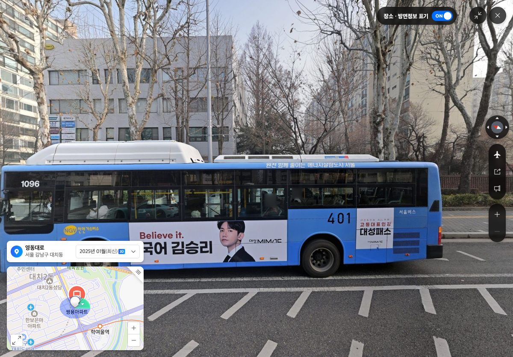
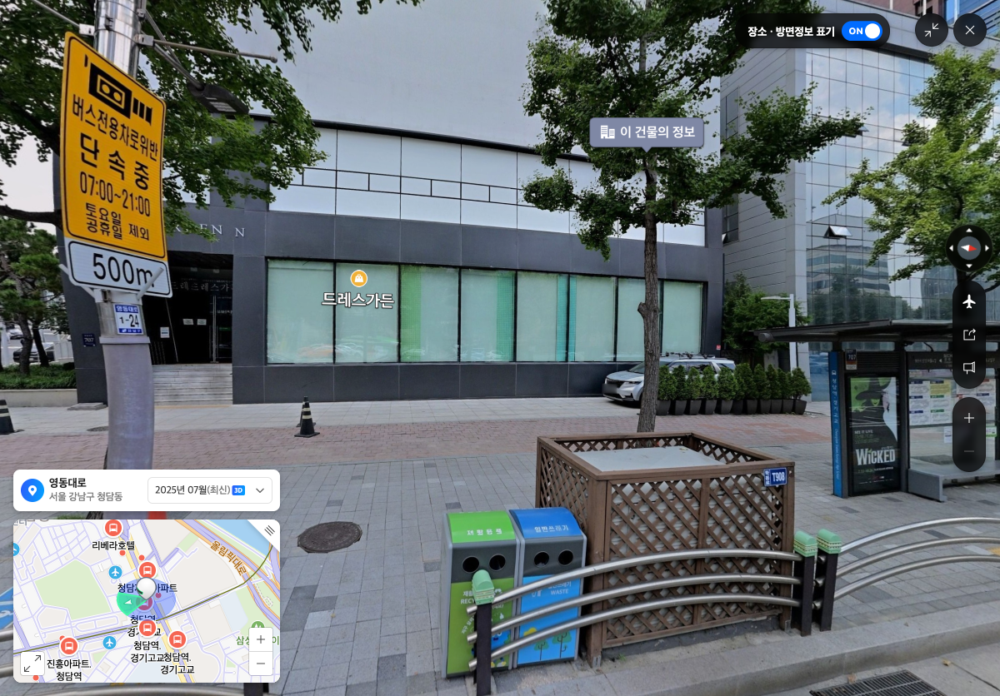
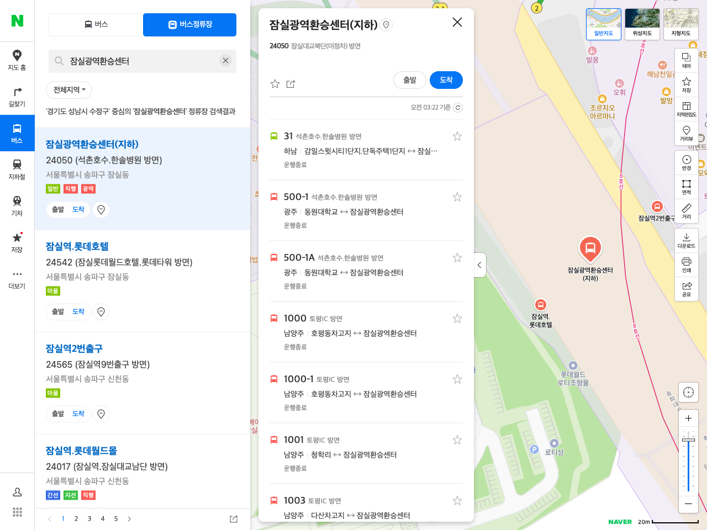

# 정류장 위치와 노선 연결을 분리한 이유

v4에서 보류된 5개 노선의 581방문을 검사했습니다. 30m를 넘은 것은 17방문/12개 정류장이고, 방문 순서·회차·인접 구간 자체는 통과했습니다. 큰 거리만으로 정류장 GPS가 틀렸거나 노선이 잘못됐다고 단정할 수 없어 원문·현재 다른 제공자·현장 화면을 대조했습니다.

## 12개 정류장 식별

| GBIS stationId | 보관 이름 | 지역·정류장 번호 | 관련 노선 | 기존 API 진단 이격(m) |
|---|---|---|---|---:|
| 122000137 | 쌍용아파트 | 서울23240 | 9507, 6900 | 37.014 |
| 122000388 | 새마을운동중앙회 | 서울23511 | 9507, 6900 | 31.285 |
| 122000386 | 총회회관.휘문고입구 | 서울23509 | 9507, 6900 | 33.483 |
| 122000139 | 삼성역 | 서울23242 | 9507, 6900 | 31.351 |
| 122000637 | 리베라호텔 | 서울23844 | 9507 | 30.621 |
| 122000068 | 청담역.경기고교 | 서울23170 | 9507 | 33.018 |
| 122000095 | 무역센터 | 서울23198 | 9507 | 33.375 |
| 122000096 | 무역센터 | 서울23199 | 9507 | 33.555 |
| 122000133 | 대치동은마아파트 | 서울23236 | 9507 | 32.978 |
| 123000611 | 잠실광역환승센터 | 서울24050 | 1007, 1009 | 96.352 |
| 123000065 | 잠실종합운동장 | 서울24154 | 6900 | 32.415 |
| 206000025 | 중앙공원.양지마을청구아파트 | 성남07143 | 3500 | 30.788 |

번호는 Naver 내부 ID를 GBIS ID로 추측해 붙이지 않았습니다. 보관 GBIS 원문과 BMS의 exact ID 행, [서울시 OA-15067 공개 원본](https://data.seoul.go.kr/dataList/OA-15067/S/1/datasetView.do)의 `서울시버스정류소위치정보(20260902).xlsx`에서 NODE_ID와 ARS_ID가 같은 행인지를 확인했습니다. 부분 BMS 자료에 없던 4건도 공식 서울시 원본의 유일한 같은 행에서 확인했습니다. `서울07143`은 망우동고개로 성남07143과 다른 정류장이므로 번호만 합치지 않습니다.

위 거리는 엔진의 WGS84 가정 진단식 값이며 측량한 GPS 오차가 아닙니다. 서울시 포털의 좌표계 설명에도 WGS84와 EPSG5179가 함께 표기되는 모순이 있어 원문 숫자를 보존하고, 진단 가정과 실제 CRS 확인을 구분했습니다. 어떤 원본 좌표도 교체하지 않았습니다.

## 영동대로 9곳: 대표 경로선과 승차 위치의 역할 차이

같은 방향의 원본 선에 대해 GBIS 좌표는 오른쪽 약30.6~37.0m, 현재 Naver 정류장 좌표도 오른쪽 약29.3~35.2m에 있습니다. 두 제공자 간 횡방향 차이는 약−5.8~+3.8m이고 큰 차이 대부분은 도로를 따른 앞뒤 차이(약−39.2~+30.9m)였습니다. Naver 점으로 교체해도 경로선과 약30m의 간격은 남습니다.

사진에는 도로변 연석과 대기 시설 또는 정차 버스가 보이며, 이 수치·현장 조합은 넓은 도로의 대표 경로와 승차 위치의 역할 차이를 강하게 뒷받침합니다. 원본 선을 실제 버스 차로 중심선이라고 인증하지 않았고, 9곳 모두의 제공 좌표를 실측 정답으로 확정한 것도 아닙니다. 최근접 foot에 대한 종방향 오차가 작다는 것 자체는 투영 정의이므로 독립 정확도 증거로 세지 않았습니다.

| 상행 쌍용아파트 · 2025년1월 거리뷰 | 하행 청담역·경기고교 · 2025년7월 거리뷰 |
|---|---|
|  |  |

각 사진은 해당 촬영월의 보이는 범위를 확인하는 자료입니다. 특정 차로의 정확한 foot나 2026년 현재 시설 위치 불변까지 입증하지 않습니다. 차로 수×일정 폭으로 일괄 오프셋을 만들지 않았습니다.

## 잠실광역환승센터: 같은 정류장과 다른 승강장

GBIS123000611/서울24050은1007·1009가 같은 좌표를 공유하는 정류장입니다. Naver의 현재 상세는 ‘잠실광역환승센터(지하)’이고 두 노선을 모두 포함합니다. [운수사 공식 게시 안내](https://www.buspia.co.kr/m/buspia/subpage/busGuide/inBus.php)는1007은9번,1009는10번 승강장을 구분합니다(게시 갱신일은 확인하지 못했습니다). 공유 정류장 좌표에는 승강장별 위치 정보가 담겨 있지 않습니다.

| 위치 자료 | 좌표 또는 역할 |
|---|---|
| 보관 GBIS 정류장 | 127.1006667,37.51235 |
| 서울시20260902 동일NODE_ID 행 | 127.1007210704,37.5123429607 |
| 현재 Naver 상세의 대표점 | 127.1011875,37.5118964 |
| 제공 노선의 공유TYPE1 회차 이벤트 | 127.101343701,37.5116712 |

동일한 진단식으로 GBIS↔서울은 약4.86m, GBIS↔Naver는68.30m, GBIS↔노선 회차점은96.35m입니다. 공식 서울점이 GBIS와 가깝다는 점도 Naver 대표점으로 원본을 덮어쓰는 방식이 적절하지 않음을 보여줍니다. 이는 어디가 정확한 승강장인지 인증하는 수치가 아닙니다.

서울시의2016년 개통 설명은 송파대로 하부의 지하 회차 시설임을 설명하고 현재 Naver도 지하센터로 분류합니다. 지상 거리뷰는 지하 승강장과 버스 진입 동선을 보여주지 않습니다. 원문 형상에 실제 지하 진입선이 생략됐는지는 이 자료만으로 확정하지 못했으므로, 직선이나 추정 도로를 새로 생성하지 않았습니다.

## 잠실종합운동장과 분당 중앙공원

123000065/서울24154는2026년6월 거리뷰에서 보도·연석 뒤 지붕/벤치/안내판과 버스 노면 표시를 확인했습니다. 206000025/성남07143은2024년7월 거리뷰에서 도로변 표지·쉼터·벤치와 보도의 분리를 확인했습니다. 둘 다 약31~32m 이격만으로 GPS 오류·정류장 폐지·이전을 확정할 근거는 없었습니다. 후자는 사진이 오래됐으므로 현재 위치 불변을 주장하지 않습니다. 같은 원본 축 기준 오른쪽 이격 패턴은 대표 경로와 승차 위치 차이를 지지하지만 정확한 차로 위치는 미확정입니다.

## 공통 코드에서 개선한 것

30m를100m로 일괄 늘리지 않았습니다. 15m 초과 위치 차이 경고는 유지하고, 30m 초과에서는 `SourceStopOccurrenceWitness`가 다음을 모두 입증해야 대표 경로를 표시합니다.

1. 원문 manifest와 전체 WEB 역할 순서가 결박되고, TYPE1 사건이 카탈로그의 같은 방향·방문 순서와 일대일로 대응한다.
2. 원본→후보의 유일한 순서 보존 대응이 있어, 같은 XY를 다른 회차에 붙이지 않는다. 인접0길이 literal alias와 다른 회차의 alias를 구분한다.
3. 실제 연결점은 원본 전역 TYPE1 이웃의 방문 구간과 후보 방문 구간의 교집합 안에 있다. 공유 회차도 양쪽 방향의 이웃을 확인한다.
4. 곡선의 최종 index/fraction을 실제 source-s로 되돌려 같은 원본 방문 구간인지 다시 확인한다.
5. 기존100m 상한·모호성·회차·끝점·모든 인접 구간·새 교차/접촉/overlap·굽힘·곡선2m 범위를 계속 통과한다. 실패하면 독립 통과한 전체 묶음으로 돌아가거나 보류한다.

변환은 노선별 예외나 정류장 좌표 테이블 없이 공통으로 수행합니다. 원본 GPS·방문·이격 경고519개와 `UNEVALUATED`를 유지합니다. 허용되는 것은 원문에서 증명한 대표 경로의 표시이며, 실제 승강장 위치·보행 경로·지하 주행 동선의 확인과 구분합니다.

독립 검토에서는 만료되는 WEB 근거의 캐시 생명주기,0길이 끝점 축,긴 회차 선분의 잘못된 방문 구간 재정의를 반례로 확인하고 차단했습니다. 정확히 공유한 끝점을 Mercator double 계산이 새 proper crossing으로 잘못 세던1650의 수치 오판도 epsilon 없이 수정했고, 실제 근접 교차와 별도 접촉/overlap 차단은 유지했습니다.

v6의 고정41개 재생은40 REVIEW_REQUIRED·1PASSED,3,215원본 방문 유지,39곡선노선/6,665곡선·2원본 구조 유지입니다. 이는 실제 승강장 좌표 검수나 전국 차로 정확도 인증이 아닙니다.
