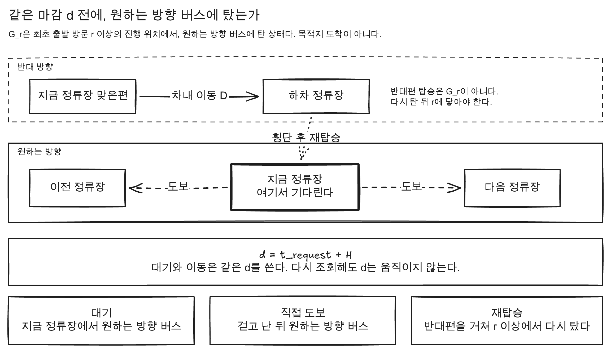
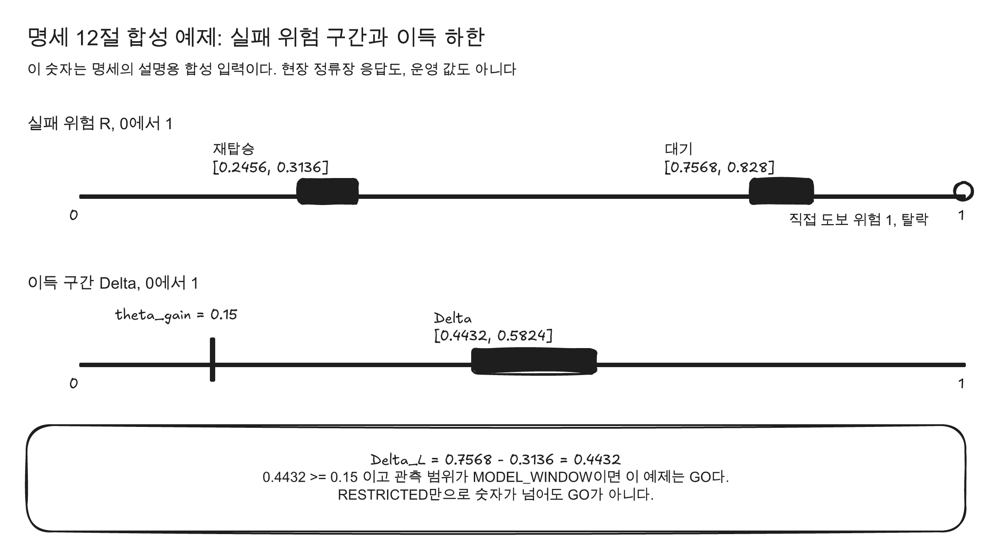
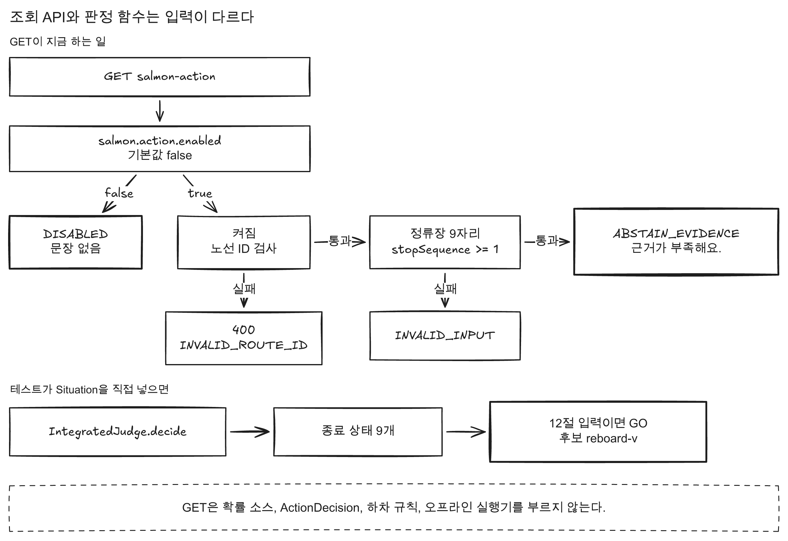

# feat(SAL-388): v2 연어행동 판정과 정류장 안내 조회 추가

이 PR은 연어행동 판정을 명세 v2의 종료 상태 아홉 개로 고른다.
같은 함수 `IntegratedJudge.decide`가 그 아홉 개를 만든다.
명세 12절의 합성 입력은 후보 `reboard-v`의 `GO`로 끝난다.
공개 조회는 그 함수를 부르지만, 현장 확률과 운행 식별자가 없어 `ABSTAIN_EVIDENCE`만 반환한다.

기준 명세는 `SALMON-MATH-integrated-v2.md`다.
SHA-256은 `1da2c4161ddc1f8bc6b5db67e15febfeda4df207136ed79c76b8c5f49b163c3d`다.
v2.1은 주석본이고, 판정 기준은 v2다.
12절의 `H`, `theta_gain`, `alpha`, `W_max`, `D_max`, `m_min`은 운영 값이 아니다.
그 숫자는 `application.yml`에 없다. 운영 값은 SAL-389에 남긴다.

## 성공은 같은 마감 전의 원하는 방향 탑승이다

`G_r`은 성공 사건이다.
원하는 방향 버스에 탄 채, 최초 출발 방문 `r` 이상의 진행 위치에 있는 상태다.
`d`는 그 요청의 절대 마감이다. 대기와 이동이 같은 `d`를 쓴다.

$$
d = t_{\mathrm{request}} + H
$$

다시 조회해도 `d`는 뒤로 밀리지 않는다.
사용자가 시간 창을 새로 정하면 그 조회는 새 요청이다.

$$
T_G^{\pi} = \inf\{ t : \pi \text{ 실행 중 } G_r \text{ 달성} \}
$$

$$
R(\pi) = P(T_G^{\pi} > d \mid I_*)
$$

`R(π)`는 행동 `π`의 실패 위험이다.
정보 `I_*`와 마감 `d`가 같을 때의 확률이다.
목표를 달성하지 못하면 `T_G`는 양의 무한대다.

`D`는 목표 또는 계획 하차까지의 계획된 차내 이동 시간이다.
대기 시간은 `D`에 넣지 않는다.
`ALLOWED`인 이동은 차내 이동 시간이 있어야 한다.

반대편에 타는 일만으로는 `G_r`이 되지 않는다.
반대편에서 내린 뒤, `r` 이상에서 원하는 방향 버스에 다시 타야 한다.
직접 도보는 걸어서 다른 정류장의 원하는 방향 버스에 타는 이동이다.
대기, 직접 도보, 재탑승은 서로 다른 경로이고, 마감은 하나다.

## 이득은 실패 위험의 하한 차이다

`L_π`는 `R(π)`의 하한이다. `U_π`는 `R(π)`의 상한이다.

$$
L_{\pi} = \inf R(\pi), \qquad U_{\pi} = \sup R(\pi)
$$

$$
\Delta_L(\pi) = L_{\mathrm{stay}} - U_{\pi}
$$

$$
\Delta_U(\pi) = U_{\mathrm{stay}} - L_{\pi}
$$

`Delta_L`은 이득 하한이다. `Delta_U`는 이득 상한이다.
이 식은 대기와 이동의 결합 제약을 쓰지 않은 보수적 범위다.
두 행동이 통계적으로 독립일 필요는 없다.

직접 탑승의 단순식은 각 성공 확률을 실패로 뒤집어 곱한다.
`q_i`는 i번째 시도의 조건부 성공 확률이다.
빈 시도열의 곱은 1이다. 실패 위험도 1이다.

$$
R_{\mathrm{direct}} = \prod_i (1 - q_i)
$$

성공 확률이 구간 `[q^L, q^U]`이면 실패 구간은 끝을 뒤집는다.

$$
L_{\mathrm{direct}} = \prod_i (1 - q_i^{U})
$$

$$
U_{\mathrm{direct}} = \prod_i (1 - q_i^{L})
$$

재탑승 한 가지의 단순식은 반대편 성공 `β`와 원하는 방향 재탑승 성공 `q`를 함께 놓칠 위험이다.

$$
L = 1 - \beta^{U} q^{U}, \qquad U = 1 - \beta^{L} q^{L}
$$

주변확률 두 개의 실패 범위는 합 제약이다.

$$
\max(0, 1 - p_1 - p_2) \le R \le \min(1 - p_1, 1 - p_2)
$$

### 명세 12절 합성 입력

이 숫자는 설명용 합성 입력이다.
현장 정류장 응답도 아니고, 운영 값도 아니다.
예제는 `H = 25`분, `d = 25`분, `theta_gain = 0.15`를 쓴다.
`alpha = 1.2`, `W_max = 20`분, `D_max = 20`분, `m_min = 0.25`분도 예제 숫자다.

점추정은 구간이 아니라 확률 하나다.
대기 성공 0.10과 0.12의 점추정은 아래와 같다.

$$
R_{\mathrm{stay}} = 0.90 \times 0.88 = 0.792
$$

반대편 성공 0.90, 재탑승 성공 0.80의 점추정은 아래와 같다.

$$
R_{\mathrm{reb}} = 1 - 0.90 \times 0.80 = 0.28
$$

$$
\Delta_{\mathrm{reb}} = 0.792 - 0.28 = 0.512
$$

같은 예제에 구간을 붙이면 대기 성공은 `[0.08, 0.12]`, `[0.10, 0.14]`다.

$$
R_{\mathrm{stay}} \in [0.88 \times 0.86,\ 0.92 \times 0.90] = [0.7568,\ 0.828]
$$

재탑승은 반대편 `[0.88, 0.92]`, 원하는 방향 `[0.78, 0.82]`다.

$$
R_{\mathrm{reb}} \in [1 - 0.92 \times 0.82,\ 1 - 0.88 \times 0.78] = [0.2456,\ 0.3136]
$$

$$
\Delta_{\mathrm{reb}} \in [0.4432,\ 0.5824]
$$

이득 하한 0.4432는 역치 0.15 이상이다.
직접 도보 `walk-beomgye`의 실패 위험은 1이라 탈락한다.
준비 시각은 `1 + 1.2 \times 16 = 20.2`분이다.
그 시각 뒤의 차는 기준점을 29분에 지난다.
마감은 25분이므로 이 목표의 실패 위험은 1이다.
`reboard-v`는 도보 4분, 환승 1회, 차내 15분이다.
관측 범위가 `MODEL_WINDOW`이면 이 예제는 `GO`다.
`partial`은 false다.
`RESTRICTED`만으로 같은 숫자가 넘어도 `GO`가 아니다.

`GO`는 아래 다섯 가지가 모두 성립하고, 그 비교가 강한 범위일 때다.

1. 경로와 허용이 확인된다.
2. 같은 목표, 같은 마감, 같은 정보, 같은 관측 범위로 대기와 비교한다.
3. 시간 오차와 확률 가정이 위험 범위 안에 들어 있다.
4. 행동에 필요한 정보가 있고, 그 결과가 아직 유효하다.
5. `Delta_L`이 `theta_gain` 이상이다.

강한 범위는 둘 중 하나다.
관측 범위가 `MODEL_WINDOW`이거나, 누락을 범위에 넣은 보수적 비교다.
`MODEL_WINDOW`는 현실의 절대 보장이 아니다.
설정한 운행 모형이 시간 창을 덮는다는 가정이다.

## `IntegratedJudge`가 고르는 순서

`IntegratedJudge`는 대기와 이동을 비교해 종료 상태 하나를 반환하는 pure function이다.
`pure function`은 같은 입력이면 같은 값을 반환하고, 필드를 바꾸지 않는 함수다.
Spring과 Jackson에 의존하지 않는다.
이득 비교에만 `1e-9`를 둔다.
정책 생략은 대기 위험 상한이 역치보다 작을 때만이다. 같으면 생략하지 않는다.

1. 모델이 모순이면 `INVALID_INPUT`이다.
2. `theta_gain`이 `(0, 1]` 밖이면 `INVALID_INPUT`이다.
3. `eta`가 유한하지 않거나 0보다 작으면 `INVALID_INPUT`이다.
4. id가 비었거나 겹치면 `INVALID_INPUT`이다.
5. 도보, 환승, 차내 시간이 유한하지 않거나 음수이면 `INVALID_INPUT`이다.
6. `ALLOWED`인데 차내 시간이 없으면 `INVALID_INPUT`이다.
7. 창이 닫혀 있으면 `WINDOW_EXPIRED`다.
8. 대기 위험이 없으면 `ABSTAIN_EVIDENCE`다.
9. 대기 위험 상한이 역치보다 작으면 `NO_MOVE_POLICY`다.
10. 강한 범위에서 `Delta_L`이 역치 이상인 후보가 있으면 `GO`다.
11. 약한 범위에서 숫자만 넘으면 `ABSTAIN_EVIDENCE`다.
12. 범위가 역치를 가로지르거나 점추정만 넘으면 `ABSTAIN_UNCERTAIN_GAIN`이다.
13. 후보가 미확인이거나 열거가 끝나지 않았으면 `ABSTAIN_EVIDENCE`다.
14. 후보가 없고 열거가 끝나면 `NO_MOVE_NO_CANDIDATE`다.
15. 후보가 모두 `VIOLATED`이면 `NO_MOVE_INFEASIBLE`이다.
16. 강한 비교에서 허용 후보의 `Delta_U`가 모두 역치 미만이면 `NO_MOVE_NO_GAIN`이다.
17. 위에 없으면 `ABSTAIN_EVIDENCE`다.

`GO`가 하나라도 있으면 열거가 덜 끝나도 그 후보를 고른다.
그때 `partial`은 true다.
아직 닫지 못한 후보가 이득 가능성을 남겨도, 그 `GO`를 `NO_MOVE_NO_GAIN`으로 바꾸지 않는다.

동점은 실패 위험 상한이 최소인 값에서 고른다.
`eta` 안에 있는 후보만 남긴다.
그다음은 도보 시간, 환승 횟수, 차내 시간, id 순이다.
`eta`가 0이면 상한이 더 낮은 후보가 남는다.
`eta`가 0.05이면 상한 차이 0.02는 남고, 도보가 짧은 후보를 고른다.

`IntegratedGuidance`가 종료 상태를 문장 하나로 바꾼다.
확률 숫자는 문장에 넣지 않는다.

| 종료 상태 | 문장 |
|---|---|
| `GO` | 이동하면 기다리는 것보다 설정한 시간 안에 원하는 방향 진행을 확보할 가능성이 높아요. |
| `NO_MOVE_POLICY` | 지금 정보에서는 기다려도 실패 위험이 낮아 이동을 찾지 않아요. |
| `NO_MOVE_NO_GAIN` | 비교한 이동은 기다리는 것보다 충분히 나아지지 않아요. |
| `NO_MOVE_NO_CANDIDATE` | 평가할 이동 후보가 없어요. |
| `NO_MOVE_INFEASIBLE` | `허용 범위 안에서 갈 수 있는 이동이 없어요.` |
| `ABSTAIN_EVIDENCE` | 이동과 대기를 비교할 근거가 부족해요. |
| `ABSTAIN_UNCERTAIN_GAIN` | 이득이 역치를 넘는지 범위로 확인하지 못했어요. |
| `INVALID_INPUT` | 요청 값이 서로 맞지 않아 판정하지 않았어요. |
| `WINDOW_EXPIRED` | 정한 시간이 지나 새 시간 창이 필요해요. |

v1 `ActionJudge`와 v1 사유 코드 일곱 개는 이 옆에 그대로 있다.
공개 조회의 `reasonCode`는 v2 아홉 개다.

## 조회가 지금 반환하는 값

경로는 `GET /api/v1/routes/{routeId}/stations/{stationId}/salmon-action`이다.
쿼리 이름은 `stopSequence`다.
응답에는 `kind`, `reasonCode`, `guidance`만 있다.
확률과 후보는 싣지 않는다.
`null` 필드는 JSON에서 빠진다.
`Cache-Control`은 `no-store`다.
OpenAPI 경로 목록에도 이 경로가 있다.

플래그 `salmon.action.enabled`의 기본값은 false다.
환경 변수는 `SALMON_ACTION_ENABLED`다.

플래그가 꺼지면 노선 ID가 잘못돼도 200과 `DISABLED`다.
문장 필드는 없다.

플래그가 켜지고 노선 ID가 9자리 숫자가 아니면 400 `INVALID_ROUTE_ID`다.
노선 ID가 맞고 정류장이 9자리가 아니거나 `stopSequence`가 1보다 작으면 200 `INVALID_INPUT`이다.
둘 다 맞으면 `Situation.missingStay()`를 판정한다.
결과는 `DECIDED`, `ABSTAIN_EVIDENCE`, 문장 `이동과 대기를 비교할 근거가 부족해요.`다.

테스트가 `Situation`을 직접 넣으면 종료 상태 아홉 개와 12절 `GO`를 만든다.
그 입력은 공개 GET이 만들지 않는다.
GET은 확률 소스, `ActionDecision`, 하차 규칙, 오프라인 실행기를 호출하지 않는다.

판정보드는 선택한 정류장에만 서버 문장을 보여 준다.
아래이면 문장을 숨긴다.

- `kind`가 `DISABLED`다.
- 요청이 진행 중이거나 실패했다.
- `kind`가 `DECIDED`가 아니거나 `reasonCode`가 아홉 개 밖이다.
- `guidance`가 비었거나, 줄표나 가운뎃점이 들어 있다.
- 응답에 `seatAvailableProbability` 키가 있다.

## 같이 둔 코드와 호출하지 않는 코드

`worktree`는 같은 저장소의 다른 체크아웃 디렉터리다.
하위 `worktree`의 커밋을 이 브랜치에 merge하지 않았다.
SAL-395는 `dev`에 이미 있다.
SAL-396과 SAL-392는 앞의 재작성 이력을 같이 가져온다.
그래서 필요한 파일만 현재 트리에 올렸다.

| 코드 | 공개 GET |
|---|---|
| `IntegratedJudge`, `RiskMath`, `IntegratedGuidance` | 호출한다 |
| `SeatForecastProbabilitySource` | 호출하지 않는다. 스프링 빈이 아니다 |
| `ActionDecision`, `WalkOptions`, `ReboardAssembly` | 호출하지 않는다. 하차 구간은 호출자가 준 목록만 조립한다 |
| `AlightingStopRule` | 호출하지 않는다 |
| `runSalmonOffline` | 호출하지 않는다. 운영 데이터베이스에 접속하지 않는다 |
| 보존 비용 스크립트, 호출 한도 테스트 | 제품 조회가 아니다 |
| v1 `ActionJudge`, v1 `PolicyEvaluator` | 조회가 호출하지 않는다 |

통합 `worktree`의 v1 `ActionJudge`, `PolicyEvaluator` diff는 가져오지 않았다.
조회 보조 타입은 컴파일만 되고 스프링 빈으로 등록하지 않았다.
보조 타입은 `SalmonStop`, `DecisionLog`, `MemoryDecisionLog`, `SalmonDecisionRecord`다.
이어서 `SalmonCandidateRoutes`, `AbsentCandidateRoutes`, `BaselineProbabilitySource`다.
이어서 `SalmonActionOutcome`, `SalmonActionException`이다.

## 현장 `GO`를 만들지 않은 이유

도착 정보에 운행 식별자와 예측 생성 시각이 없다.
근거는 SAL-387, PR #275다.
빈자리 수는 조건부 탑승 확률이 아니다.
차량 두 대의 응답만으로 `MODEL_WINDOW`를 주지 않는다.
`D` 계산, 하차 구간, 확률 소스를 현장 응답의 `GO`에 연결하지 않았다.
판정 기록 저장은 아직 없다.

## 검증

`IntegratedJudgeTest`가 종료 상태 아홉 개와 12절 구간, 12절 점추정을 고정한다.
구간 비교 허용 오차는 `1e-9`다.
공개 조회 테스트는 플래그 꺼짐, 근거 부족, 정류장 형식 오류, 노선 ID 400을 고정한다.

`backend/test-baseline.properties`의 실행 수는 api-app 1518건, arrivals 48건이다.
skipped는 0건이다.
이 수로 `verifyTestCount`가 통과했다.

판정보드의 켠 상태 문장은 브라우저에서 누르지 못했다.
플래그 기본값이 false라 화면은 문장을 숨긴다.

## 리뷰에서 보면 좋은 것

1. `IntegratedJudgeTest`의 `명세_12절_범위는_재탑승을_GO로_고른다`가 `reboard-v`를 고르는지 본다.
2. 플래그가 꺼진 잘못된 노선 ID가 200 `DISABLED`인지 본다.
3. 플래그가 켜진 정상 ID가 `ABSTAIN_EVIDENCE`인지 본다.
4. 플래그가 켜진 잘못된 노선 ID가 400 `INVALID_ROUTE_ID`인지 본다.
5. 판정보드가 선택 정류장에만 문장을 두는지 본다.
6. 응답 JSON에 확률 필드가 없는지 본다.
