# SAL-249 · 그룹별 즐겨찾기 전체 변경과 리뷰 안내

안녕하세요 레스, 루멘입니다!

자주 타는 노선의 정류장을 그룹별로 저장하고, 홈에서 도착 시간과 좌석 예보를 바로 확인할 수 있도록 구현했습니다. 판정보드의 별에서 저장한 내용이 홈 조회와 해당 정류장 지도 이동으로 이어지고, 마이페이지에서는 그룹과 정류장을 관리할 수 있습니다.

처음 API 초안으로 시작한 뒤 실제 배포 계약을 맞추고, 시안과 인터랙션을 조정하면서 변경이 많이 쌓였는데요. 이번에는 작업 순서대로 덧붙이던 설명을 걷어내고 **최종 동작 → 전체 구조 → 읽는 순서 → 중점 리뷰** 순서로 다시 정리했습니다. 화면을 먼저 보신 다음 타입과 API부터 따라가시면 파일 수에 비해 흐름은 편하게 보실 수 있을 것 같습니다!

> 구현 범위는 `dev`의 `74147a437`부터 후속 기능 커밋 `ea748e6c8`까지입니다. 앱 캡처·Excalidraw 구조도·아래 기능 코드 링크는 촬영 기준 `05d3f607c`를 유지하며, 자료 커밋 `38b0b9b62` 이후의 그룹 전환·스켈레톤·닉네임 클릭 영역·홈 배경·채팅 아이콘 변경도 PR에 포함했습니다. 기존 인증·로그아웃·탈퇴는 재사용했고, 백엔드 즐겨찾기 구현은 별도 PR #149/SAL-235에서 합쳐진 작업입니다.

### 후속 기능 반영 · ea748e6c8

보관 중이던 15개 파일도 모두 커밋했습니다. 홈 그룹 전환 중 이전 카드·공간을 유지하고 새 응답을 페이드로 표시하며, 조회 중 카드는 `inert`로 잘못된 정류장 선택을 막습니다. 편집 진입 시 기존 명칭을 전달하고 미조회 항목은 스켈레톤으로 공간을 유지합니다. 닉네임은 연필만 수정 링크로 연결하고, 홈 바깥 주황 배경과 채팅 말풍선 아이콘도 보완했습니다.

타입·린트·포맷과 관련 E2E 256개를 통과했고, Chromium 전용 터치 조건 2개는 제외했습니다. [후속 변경 diff](https://github.com/woowacourse-teams/2026-salmonbus/compare/38b0b9b6203eb9e163b46cd0b9e9646991014afb...ea748e6c830995f630c8406c46e82e98ad502711), [홈 그룹 전환](https://github.com/woowacourse-teams/2026-salmonbus/blob/ea748e6c830995f630c8406c46e82e98ad502711/frontend/src/pages/route-select/components/HomeFavorites.tsx#L46), [편집 로딩](https://github.com/woowacourse-teams/2026-salmonbus/blob/ea748e6c830995f630c8406c46e82e98ad502711/frontend/src/shared/components/favorite-editor/FavoriteEditor.tsx#L39)에서 이어서 보실 수 있습니다.

## 1. 먼저 실제 앱 화면을 봐주시면 좋겠습니다

아래 18장은 디자인 원본이나 다시 그린 화면이 아니라 **커밋된 React 앱을 실행해서 촬영한 PNG**입니다. 425×844 CSS 화면을 DPR 3으로 촬영해 원본은 모두 **1275×2532px**입니다. 작게 보이면 이미지를 눌러 원본으로 확인하실 수 있습니다.

데이터와 지도 SDK는 기존 E2E 대역을 사용했습니다. 화면·입력·모달·토스트는 앱 코드 그대로이며, 실제 회원의 그룹을 만들거나 삭제하지 않았습니다. 특히 지도 배경은 실제 네이버 지도의 화질·동작을 검증한 자료가 아닙니다. [캡처 조건·화면별 설명·원본 해시](screens/README.md)도 남겼습니다.

### 비회원은 안내를 보고 로그인한 뒤 원래 화면으로 돌아옵니다

홈에는 즐겨찾기를 설명하는 로그인 안내 카드를, 마이페이지에는 살몽이 로고와 환영 안내를 넣었습니다. 두 화면의 제목·캡션 크기도 맞췄습니다. 판정보드에서 별을 누르면 로그인 팝업을 표시하며, 로그인 주소에 현재 노선·방면·정류장 위치를 담습니다. 로그인 후에는 원래 판정보드로 돌아오고, 등록은 사용자가 별을 다시 눌러 진행합니다.

|                             비회원 홈                             |                              살몽이 마이페이지                              |                                판정보드 로그인 안내                                 |
| :---------------------------------------------------------------: | :-------------------------------------------------------------------------: | :---------------------------------------------------------------------------------: |
| 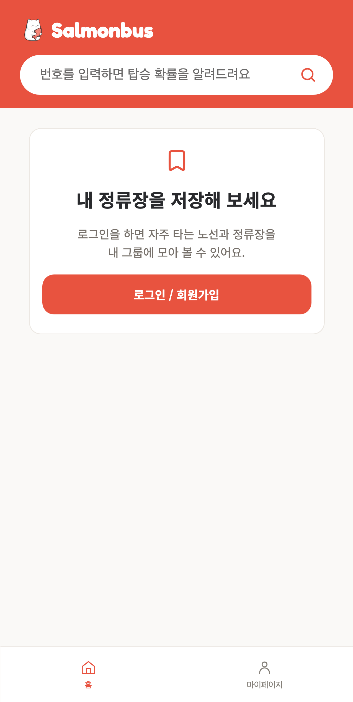 | 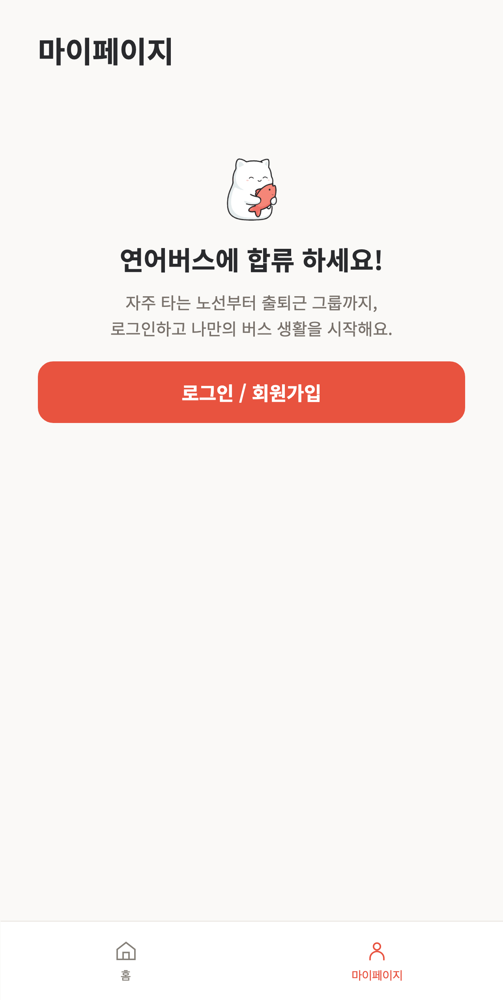 | 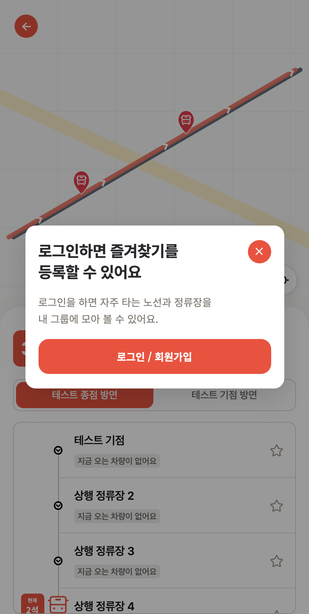 |

### 홈에서는 선택한 그룹의 도착·좌석 예보를 보여줍니다

첫 진입에는 저장 순서상 첫 그룹을 선택하고, 탭을 바꾸면 해당 그룹만 조회합니다. 노선번호·정류장명·방면과 접근 차량 최대 3대의 도착 시간·남은 정류장 수·예상 좌석을 표시합니다. ETA가 없는 차량도 좌석 예보는 남기고, 시간이 지난 ETA를 0분으로 계속 보여주지 않습니다.

차량 없음·준비 중·이용 불가·방문 확인 필요·항목 조회 실패는 각각 안내하면서 즐겨찾기를 유지합니다. 처음 조회에 실패하면 오류 화면과 재시도를 제공하고, 이미 받은 데이터의 갱신 실패에는 마지막 성공 결과를 남깁니다. 노선·정류장 표시 정보가 생략돼도 ID와 저장 방면으로 카드를 유지하고 이동할 수 있게 했습니다.

홈의 즐겨찾기 수정은 모달을 띄우는 대신 **기존 즐겨찾기 영역 자체를 편집 화면으로 바꿉니다.** 검색 헤더와 하단 탭은 유지하고, 그룹은 좌우·정류장은 위아래 손잡이로 이동합니다.

|                               홈 도착·좌석 예보                               |                                  차량 없음·항목 조회 실패                                  |                                 화면 안에서 순서 편집                                 |
| :---------------------------------------------------------------------------: | :----------------------------------------------------------------------------------------: | :-----------------------------------------------------------------------------------: |
| 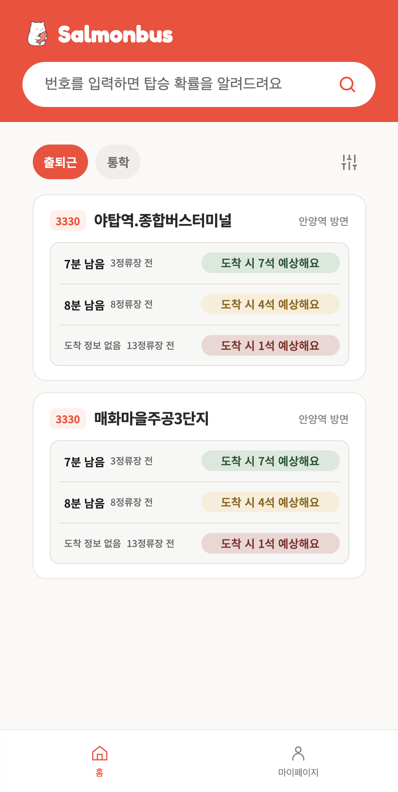 | 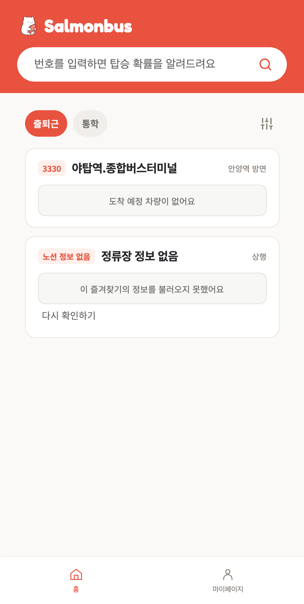 | 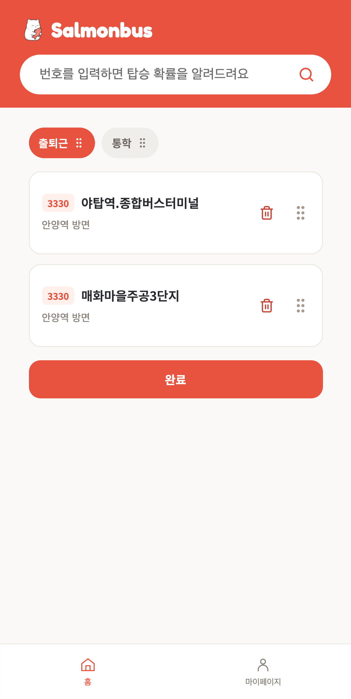 |

### 판정보드에서는 여러 그룹에 저장하고, 모달 안에서 그룹도 만듭니다

승차 가능한 정류장에 별을 표시합니다. 접힌 상태에서는 행의 세로 중앙, 펼친 상태에서는 정류장 이름의 세로 중앙으로 부드럽게 이동합니다. 별은 펼치기 버튼과 분리해 별 클릭이 정류장 펼침으로 겹쳐 처리되지 않게 했습니다.

저장 모달에서는 기존 선택을 유지한 채 여러 그룹에 한 번에 등록·해제합니다. 제목 아래 정류장명·방면 캡션은 제거했고, ‘새 그룹 만들기’를 넣었습니다. **그룹은 즉시 생성·자동 선택하고, 즐겨찾기 할당은 별도의 ‘저장’으로 반영합니다.** 모달을 취소해도 이미 만든 그룹은 남습니다. 생성 후 목록 갱신이 느릴 때는 정상적인 새 그룹을 누락으로 판단하지 않도록 저장과 중복 생성을 잠급니다.

어느 그룹에든 등록돼 있으면 채움별을 표시합니다. 모든 선택을 해제하면 모든 그룹에서 해당 즐겨찾기를 해제합니다. 최초 등록 토스트는 ‘즐겨찾기를 저장했습니다’, 이미 등록된 별의 그룹 할당 수정·해제는 ‘변경사항을 저장했습니다’로 구분했습니다.

|                                   펼친 정류장의 별·예보                                    |                                  저장 그룹 다중 선택                                   |                                 모달 안에서 그룹 생성                                 |
| :----------------------------------------------------------------------------------------: | :------------------------------------------------------------------------------------: | :-----------------------------------------------------------------------------------: |
| 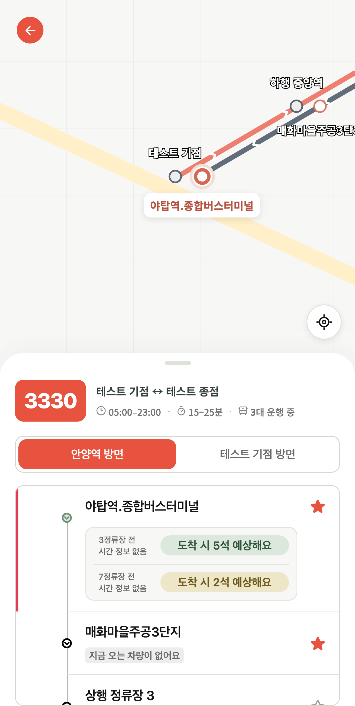 | 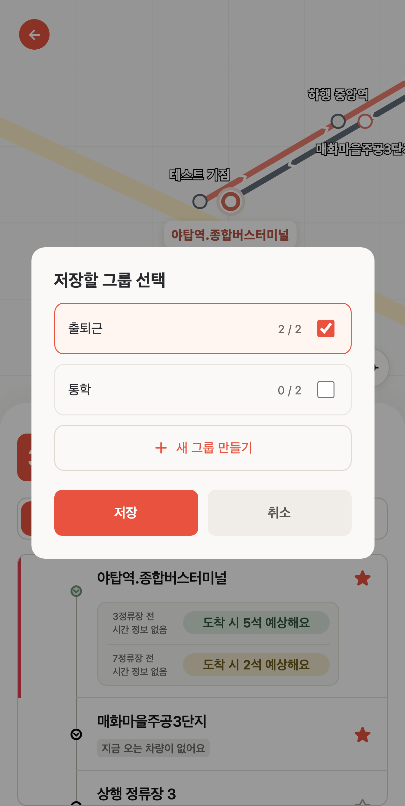 | 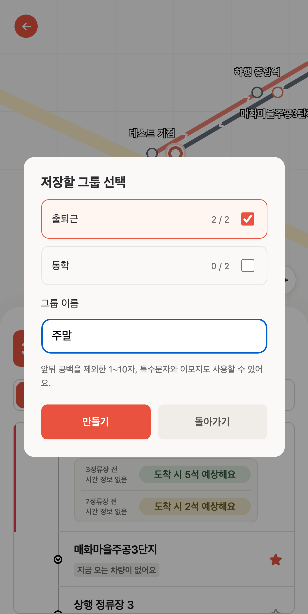 |

### 편집과 그룹 상세의 빈 상태·삭제 동작도 맞췄습니다

편집 화면과 그룹 상세의 빈 상태는 `0 / 2`와 ‘아직 등록한 정류장이 없어요’를 공통 UI로 표시합니다. 일반 홈의 빈 상태는 북마크와 ‘등록된 즐겨찾기가 없어요’, 추가 안내를 보여줍니다.

정류장 카드의 테두리와 그룹 탭 높이는 편집 전후 유지하고, 손잡이 공간은 편집을 누른 뒤에 생깁니다. 편집 중 휴지통은 확인 후 현재 그룹에서만 즉시 삭제합니다. 순서 저장을 취소해도 이미 삭제된 항목은 돌아오지 않습니다.

그룹 상세에는 노선·정류장·방면과 개별 삭제를 표시하고, 이름 변경은 제목 → 변경할 그룹 이름 → 입력창 → 정책 → 저장 순서로 전환합니다. 뒤로 가면 미저장 입력을 버리고 그룹 상세로 돌아옵니다.

|                                편집 중 빈 그룹                                 |                                   현재 그룹의 항목 삭제                                   |                                 그룹 이름 변경                                  |
| :----------------------------------------------------------------------------: | :---------------------------------------------------------------------------------------: | :-----------------------------------------------------------------------------: |
| 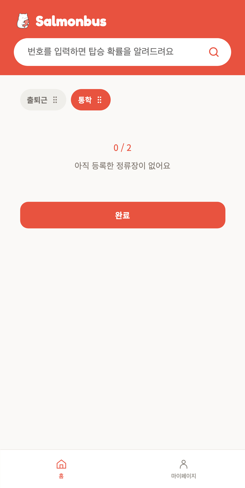 | 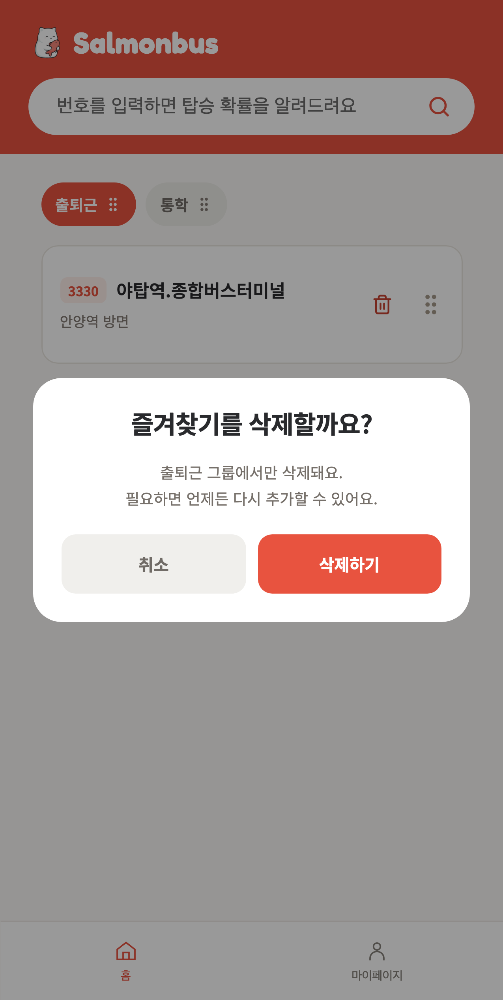 | 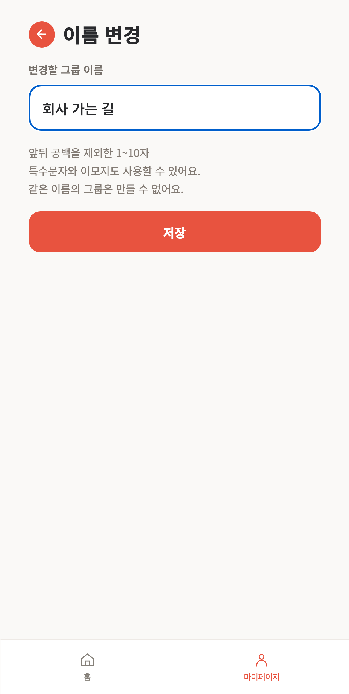 |

### 마이페이지에서는 대표 그룹을 구분하고 나머지를 여러 개 삭제합니다

**저장된 순서의 첫 번째 그룹이 항상 대표입니다.** 처음 만든 ID나 특정 이름에 고정하지 않습니다. 순서를 저장하면 대표도 바뀝니다. 목록에는 ‘이름 · 대표 그룹’, 상세에는 ‘대표’ 배지를 표시합니다. 대표 그룹도 이름 변경과 내부 정류장 삭제는 가능하지만, 그룹 자체를 삭제하려면 상세에서 보호 안내를 보여줍니다.

즐겨찾기 수정은 Yborp의 세로 슬라이더 아이콘을 쓰고, 왼쪽에 그룹 삭제 휴지통을 추가했습니다. 삭제 모드에서는 대표에 체크박스를 주지 않고 나머지를 여러 개 선택합니다. 상단 ‘취소’는 일반 목록으로, 확인 모달의 ‘취소’·Escape는 기존 선택으로 돌아갑니다. 확인 후 삭제하면 실제 삭제 개수의 토스트를 표시합니다.

|                              대표 표시·삭제·순서 편집                               |                                  그룹 상세·정류장 삭제                                  |                                       대표 그룹 삭제 보호                                        |
| :---------------------------------------------------------------------------------: | :-------------------------------------------------------------------------------------: | :----------------------------------------------------------------------------------------------: |
| 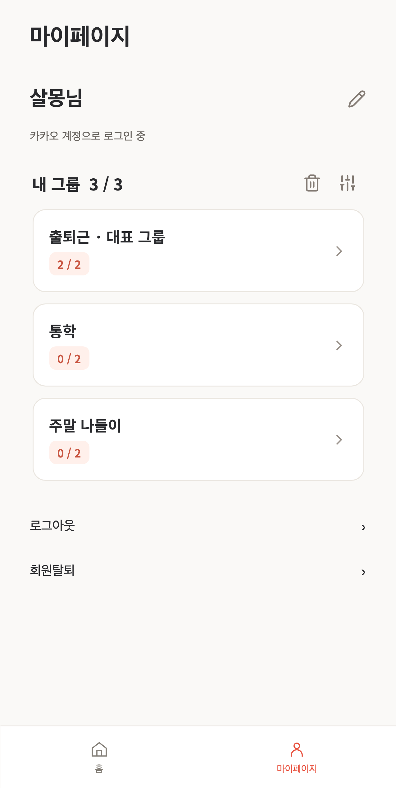 | 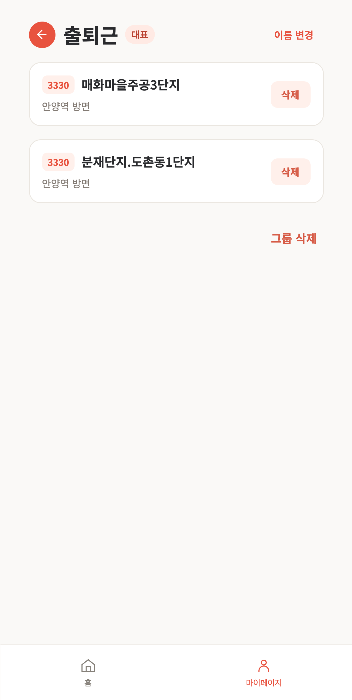 | 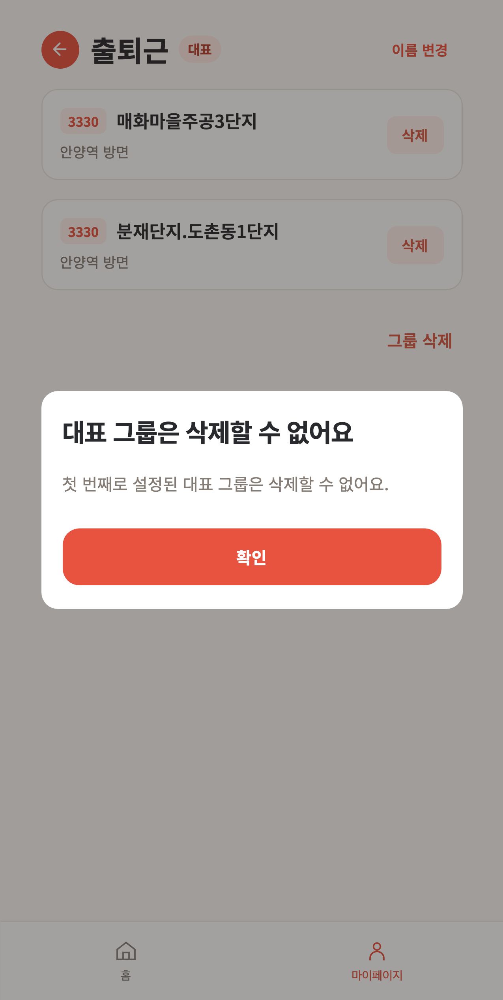 |

|                                  대표 제외 다중 선택                                   |                                 선택한 그룹 삭제 확인                                  |                                  대표 유지·삭제 완료                                  |
| :------------------------------------------------------------------------------------: | :------------------------------------------------------------------------------------: | :-----------------------------------------------------------------------------------: |
| 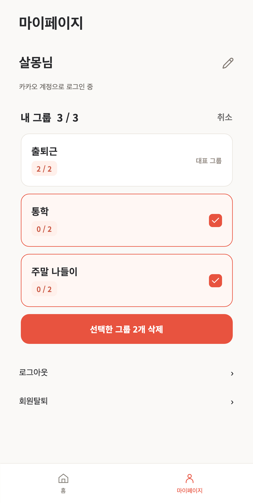 | 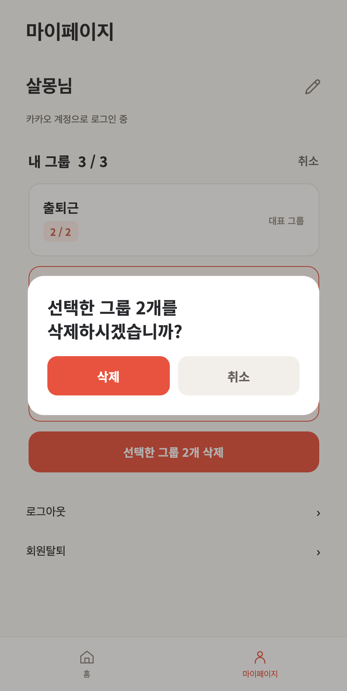 | 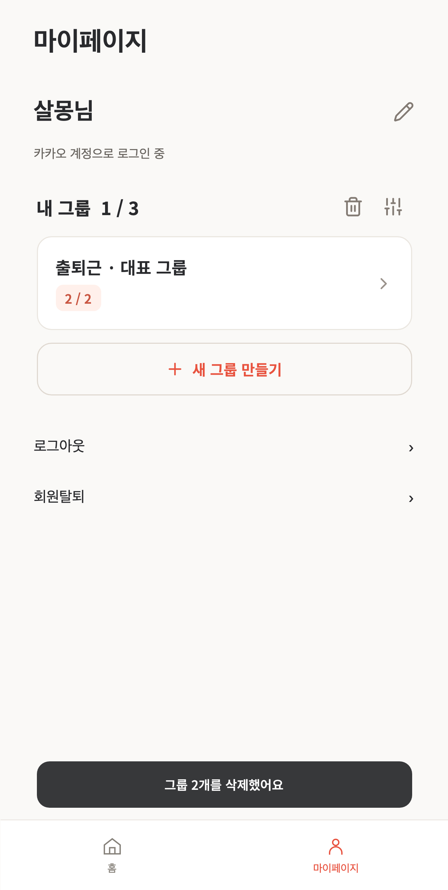 |

홈·마이페이지 하단 탭 전환에는 본문 진입 페이드와 선택 색 전환을 넣었고, 하단 탭 위치는 고정했습니다. 브랜드 글꼴·로고 간격·홈 링크, 편집 완료 아래 로그아웃 간격과 그룹 삭제 버튼의 우측 여백도 함께 맞췄습니다.

## 2. 전체 구조는 이렇게 연결됩니다

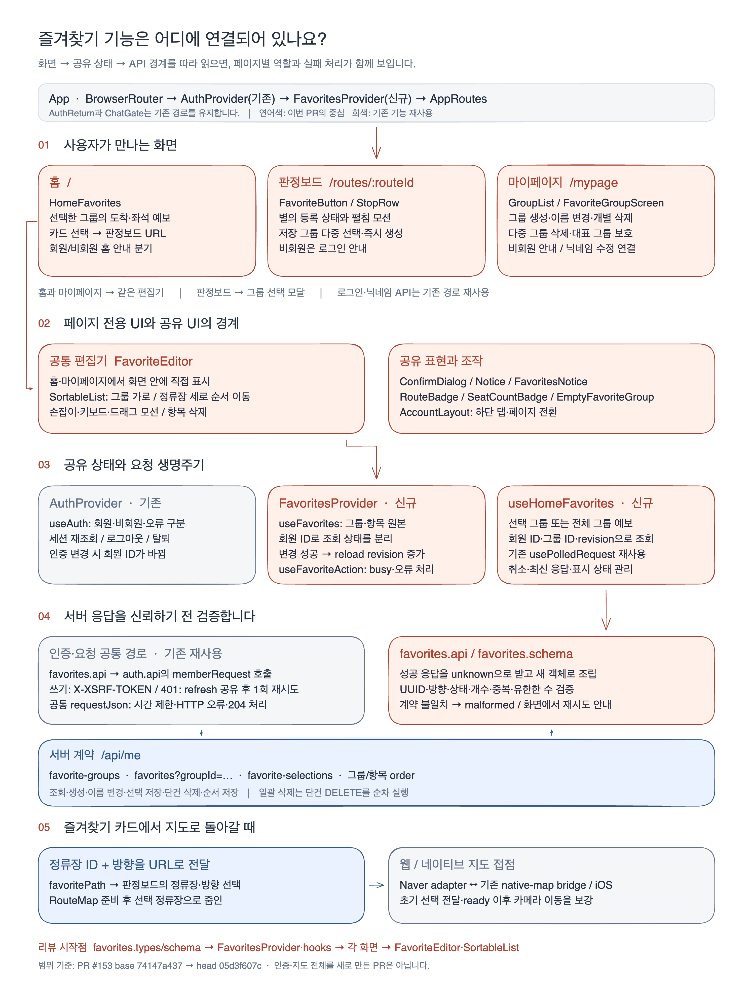

[수정 가능한 Excalidraw 원본](diagrams/favorites-architecture.excalidraw) · [SVG 원본](diagrams/favorites-architecture.svg)

페이지 전용 UI는 각 페이지의 `components/`와 `assets/`에 두고, 두 화면 이상이 쓰는 편집기·훅·배지·정책은 `shared/`로 옮겼습니다. 프로바이더 조립은 `app/`이 맡습니다. 기존 `features/favorites`는 제거했으며, 이번 PR에서 수정한 페이지 루트에는 공개 페이지와 `index.ts`만 남겼습니다.

`FavoritesProvider`는 회원 ID를 키로 그룹 원본과 갱신 revision을 관리합니다. 홈 상세는 회원·그룹 ID로 구분하고, mutation 성공 후 같은 그룹도 다시 조회할 수 있게 기존 `usePolledRequest`에 revision을 추가했습니다. 비회원·계정 변경·오래된 응답이 서로 섞이지 않는지 이 경계를 봐주시면 좋겠습니다.

즐겨찾기 요청은 기존 `memberRequest`의 XSRF·401 refresh·재시도 경로를 씁니다. 성공 응답은 `unknown`으로 받아 즐겨찾기 전용 파서에서 필요한 필드만 검증해 새 객체로 만듭니다. 기존 인증이나 REST 전체를 새로 만든 PR은 아닙니다.

즐겨찾기 카드에서 판정보드로 갈 때는 `direction + stopId`를 URL로 전달합니다. 지도 초기 중심은 유효한 선택 정류장에 두고 줌 13에서 시작해, 준비 후 웹에서 560ms 동안 15까지 확대합니다. 네이티브 scene에도 초기 선택을 전달하고 iOS 초기 카메라를 맞췄습니다. 준비 후 기존 카메라 명령은 남겨 이전 앱과의 호환을 유지했습니다.

## 3. 어디서부터 보면 좋을까요?

파일 이동과 캡처가 함께 있어 diff가 커 보입니다. **처음에는 타입·API → 상태 → 화면 → 저장/삭제 → 인터랙션 순서**로 봐주시면 감사하겠습니다. 아래 링크는 캡처한 기능 커밋의 실제 코드 위치입니다.

| 순서             | 먼저 볼 파일                                                                                                                                                                                                                                                                                                                                                                              | 여기서 확인할 내용                                                                                                                          |
| ---------------- | ----------------------------------------------------------------------------------------------------------------------------------------------------------------------------------------------------------------------------------------------------------------------------------------------------------------------------------------------------------------------------------------- | ------------------------------------------------------------------------------------------------------------------------------------------- |
| ① 정책·모델      | [favorites.types.ts](https://github.com/woowacourse-teams/2026-salmonbus/blob/05d3f607cb97c7794bc819e65924e2a8730e37ea/frontend/src/shared/api/favorites.types.ts#L3) → [favoritePolicy.ts](https://github.com/woowacourse-teams/2026-salmonbus/blob/05d3f607cb97c7794bc819e65924e2a8730e37ea/frontend/src/shared/utils/favoritePolicy.ts#L5)                                             | 그룹 3개·그룹당 2개, routeId+stopId+direction 식별, 이름 규칙, 표시 정보와 ETA 상태를 먼저 확인해 주세요.                                   |
| ② 서버 경계      | [favorites.api.ts](https://github.com/woowacourse-teams/2026-salmonbus/blob/05d3f607cb97c7794bc819e65924e2a8730e37ea/frontend/src/shared/api/favorites.api.ts#L8) → [favorites.schema.ts](https://github.com/woowacourse-teams/2026-salmonbus/blob/05d3f607cb97c7794bc819e65924e2a8730e37ea/frontend/src/shared/api/favorites.schema.ts#L66)                                              | 요청 경로, terminalStopName, optional 표시 정보, 검증 실패와 오류 계약을 봐주시면 화면의 분기가 이어집니다.                                 |
| ③ 회원·조회 상태 | [FavoritesProvider.tsx](https://github.com/woowacourse-teams/2026-salmonbus/blob/05d3f607cb97c7794bc819e65924e2a8730e37ea/frontend/src/app/providers/FavoritesProvider.tsx#L12) → [useFavorites.ts](https://github.com/woowacourse-teams/2026-salmonbus/blob/05d3f607cb97c7794bc819e65924e2a8730e37ea/frontend/src/shared/hooks/useFavorites.ts#L25)                                      | 회원별 요청 분리, 선택 그룹 조회, 저장 후 revision 갱신, 이전 성공 결과 보존을 봐주세요. 공통 usePolledRequest의 기존 호출도 유지합니다.    |
| ④ 사용자 주 경로 | [HomeFavorites.tsx](https://github.com/woowacourse-teams/2026-salmonbus/blob/05d3f607cb97c7794bc819e65924e2a8730e37ea/frontend/src/pages/route-select/components/HomeFavorites.tsx#L27) → [FavoriteButton.tsx](https://github.com/woowacourse-teams/2026-salmonbus/blob/05d3f607cb97c7794bc819e65924e2a8730e37ea/frontend/src/pages/verdict-board/components/FavoriteButton.tsx#L120)     | 홈에서 조회·이동하고 판정보드에서 등록/해제하는 경로입니다. 모달 그룹 생성은 할당 저장과 별개로 즉시 반영됩니다.                            |
| ⑤ 편집 저장      | [FavoriteEditor.tsx](https://github.com/woowacourse-teams/2026-salmonbus/blob/05d3f607cb97c7794bc819e65924e2a8730e37ea/frontend/src/shared/components/favorite-editor/FavoriteEditor.tsx#L56) → [SortableList.tsx](https://github.com/woowacourse-teams/2026-salmonbus/blob/05d3f607cb97c7794bc819e65924e2a8730e37ea/frontend/src/shared/components/favorite-editor/SortableList.tsx#L59) | draft/saved 구분, 성공한 순서만 확정, 남은 요청 재시도, 즉시 항목 삭제와 드래그 좌표 측정을 봐주시면 좋겠습니다.                            |
| ⑥ 그룹 관리      | [GroupList.tsx](https://github.com/woowacourse-teams/2026-salmonbus/blob/05d3f607cb97c7794bc819e65924e2a8730e37ea/frontend/src/pages/my-page/components/GroupList.tsx#L28) → [GroupDetails.tsx](https://github.com/woowacourse-teams/2026-salmonbus/blob/05d3f607cb97c7794bc819e65924e2a8730e37ea/frontend/src/pages/favorite-group/components/GroupDetails.tsx#L93)                      | 대표 제외·다중 삭제의 첫 실패 중단·재시도와 상세 단건 삭제를 비교해 주세요. 이름 변경은 GroupNameForm에 있습니다.                           |
| ⑦ 지도 진입      | [VerdictBoardScreen.tsx](https://github.com/woowacourse-teams/2026-salmonbus/blob/05d3f607cb97c7794bc819e65924e2a8730e37ea/frontend/src/pages/verdict-board/components/VerdictBoardScreen.tsx#L150) → [RouteMap.tsx](https://github.com/woowacourse-teams/2026-salmonbus/blob/05d3f607cb97c7794bc819e65924e2a8730e37ea/frontend/src/pages/verdict-board/map/RouteMap.tsx#L142)            | 초기 선택 유효성, 준비 전/후 포커스, 중복 확대 방지입니다. 다음으로 naverMapAdapter·nativeMapAdapter·Swift 초기 카메라를 보면 됩니다.       |
| ⑧ 회귀 근거      | [group-bulk-delete.spec.ts](https://github.com/woowacourse-teams/2026-salmonbus/blob/05d3f607cb97c7794bc819e65924e2a8730e37ea/frontend/e2e/group-bulk-delete.spec.ts#L18) → [favorite-sort-motion.spec.ts](https://github.com/woowacourse-teams/2026-salmonbus/blob/05d3f607cb97c7794bc819e65924e2a8730e37ea/frontend/e2e/favorite-sort-motion.spec.ts#L41)                               | 다중 삭제 첫/두 번째 실패와 대표 변경, 놓기 전후 프레임의 역방향 점프를 실제 입력으로 검증합니다. 나머지 테스트 위치는 아래에 정리했습니다. |

## 4. 특히 이 부분을 중점적으로 봐주시면 감사하겠습니다

### 저장·생성·삭제는 서버에 반영되는 시점이 다릅니다

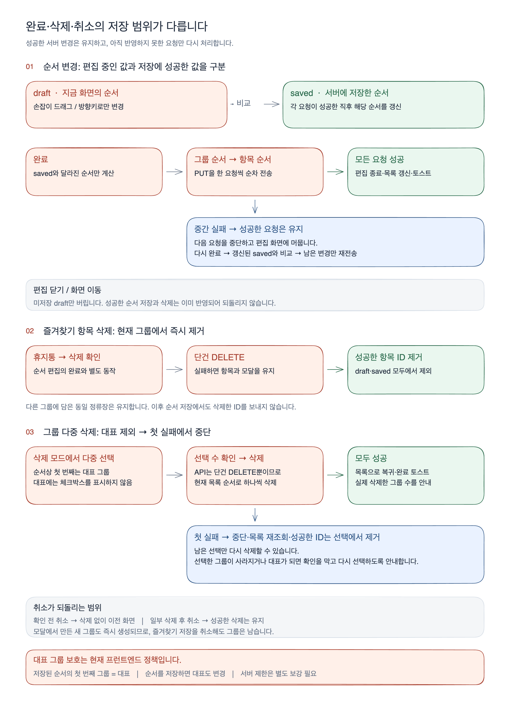

[수정 가능한 Excalidraw 원본](diagrams/favorites-save-and-delete.excalidraw) · [SVG 원본](diagrams/favorites-save-and-delete.svg)

| 동작                    | 반영 시점                                   | 실패·취소 시 남는 결과                                                                                                                   |
| ----------------------- | ------------------------------------------- | ---------------------------------------------------------------------------------------------------------------------------------------- |
| 판정보드의 그룹 할당    | ‘저장’에서 최종 선택 ID 전체를 PUT          | 서버의 한 요청으로 등록·해제를 함께 반영합니다. 실패하면 기존 선택과 입력을 유지합니다.                                                  |
| 모달 안 그룹 생성       | ‘만들기’에서 POST로 즉시 생성               | 새 그룹은 자동 선택합니다. 이후 할당 저장이나 모달을 취소해도 생성한 그룹은 남습니다.                                                    |
| 그룹·정류장 순서        | ‘완료’에서 변경된 순서 API를 순차 호출      | 성공한 순서는 saved에 반영합니다. 중간 실패 후에는 아직 저장하지 못한 요청만 보냅니다.                                                   |
| 편집·상세의 정류장 삭제 | 확인창에서 삭제한 즉시 DELETE               | 현재 그룹에서만 제거합니다. draft/saved에서 삭제된 ID를 함께 지워, 다른 미저장 순서와 이미 완료한 삭제를 유지합니다.                     |
| 여러 그룹 삭제          | 확인창에서 개별 DELETE를 표시 순서대로 실행 | 첫 실패에서 멈춥니다. 이미 삭제한 그룹은 다시 보내지 않고 실패·미요청 그룹만 재시도합니다. 부분 성공 후 취소해도 성공한 삭제는 남습니다. |

그룹 순서와 그룹 안의 항목 순서는 API가 따로라 전체를 하나의 트랜잭션처럼 취급할 수 없었습니다. 이 부분은 사용자의 요청에 맞춰 **이미 반영한 결과를 유지하고 남은 요청만 다시 보내는 방식**으로 맞췄습니다. 다중 삭제도 같은 성공 보존 원칙을 쓰되, **첫 실패에서 중단**합니다. 새 그룹 생성과 즐겨찾기 할당도 별도 요청입니다. 이 차이가 코드와 안내에서 일관되는지를 가장 먼저 봐주시면 좋겠습니다!

### 대표 그룹 보호는 현재 FE에서 담당합니다

대표는 현재 저장 순서의 첫 그룹입니다. 상세에서는 보호 모달만 보여주고, 다중 삭제에서는 선택할 수 없게 했습니다. 선택한 그룹이 목록에서 사라지거나 새 대표가 되어 삭제 대상에서 제외되면 확인을 막습니다. 다만 서버는 여전히 마지막 그룹만 `LAST_FAVORITE_GROUP`으로 보호합니다. 다른 기기의 동시 변경까지 포함한 대표 보호는 서버 정책 정합이 더 필요하고, 이 PR에서 완료했다고 적지는 않았습니다.

### 가득 찬 그룹의 기존 선택과 새로운 등록을 구분합니다

이미 2개가 있는 그룹이라도 현재 정류장이 들어 있다면 유지·해제를 허용합니다. 새 정류장을 추가할 때만 제한하고, 같은 조합을 다른 그룹에 저장하는 것은 허용합니다. 전체 체크 해제도 정상적인 해제 요청입니다. 중복 등록이나 이미 해제된 항목의 재해제는 서버의 멱등 계약을 따릅니다.

### 응답의 정보 없음과 잘못된 응답을 구분합니다

현재 배포 필드는 `route.terminalStopName`이며 FE가 ‘ 방면’을 붙입니다. `directionName`은 초기 초안 이름이어서 최종 계약에서는 사용하지 않습니다. 표시용 노선명·종점명·정류장명·방면은 생략될 수 있지만, 값이 있으면 타입을 검증합니다. UUID·중복 ID·목록 개수·상태·유한한 숫자·확률 범위·날짜와 ETA 상태별 필수 필드를 검증하고, 타입에서는 ETA의 모순 조합을 막습니다. 알 수 없는 새 상태를 정상 카드로 덮어쓰지는 않습니다.

시간이 없는 차량의 좌석 예보나 정상적인 UNAVAILABLE 항목은 유지하고, 파싱 자체가 실패한 응답은 malformed로 처리합니다. `requestId` 없는 오류를 허용한 것도 즐겨찾기 요청에 한정했습니다. 기존 REST 성공 응답 전체의 런타임 파서 전환은 [SAL-140](https://higgs95.atlassian.net/browse/SAL-140)에 남아 있습니다.

### 드래그와 지도 모션을 없애지 않고 연결 문제를 고쳤습니다

아래로 놓을 때는 이전 CSS 전환이 DOM 순서 변경 후의 좌표 측정에 남아 주변 카드가 되돌아가는 문제가 있었습니다. 기존 화면 위치를 기억한 다음, 남은 행 애니메이션을 취소하고 새 위치를 재도록 공용 SortableList를 보완했습니다. 위/아래 이동, 취소, 키보드, 서로 다른 너비의 그룹, 모션 줄이기를 함께 확인했습니다.

지도는 선택 정류장 중심으로 바로 시작하면서도 준비 후 줌인이 보여야 합니다. 초기부터 15로 고정하거나 같은 선택을 중복 포커스해서 모션을 끊지 않는지, 잘못된 정류장·방면에서는 전체 노선으로 시작하는지 봐주시면 좋겠습니다. 사용자의 wheel/touch/pointer/key 입력은 자동 카메라 이동을 중단합니다.

### 기존 탐색·인증·접근성은 계속 동작해야 합니다

비회원도 검색과 판정보드를 쓰고, 인증 조회 오류를 비회원으로 단정하지 않습니다. 기존 로그인·로그아웃·회원탈퇴와 Apple 재인증 연결을 재사용합니다. 네이티브 소셜 인증 전체 흐름은 별도 [SAL-239](https://higgs95.atlassian.net/browse/SAL-239) 범위입니다.

모달의 취소/Escape·닫힘 후 초점, 삭제로 원래 버튼이 사라진 경우의 초점 복구, 처리 중 중복 클릭·취소 차단도 확인해 주시면 좋겠습니다. 판정보드 모달이 열린 동안 네이티브 지도에 입력이 통과하지 않도록 overlay bridge도 연결했고, 별·손잡이·토스트·하단 탭·지도 모션은 모션 줄이기를 따릅니다.

## 5. 파일 이동과 구현 범위도 함께 정리했습니다

- [FE 폴더 구조](https://higgs95.atlassian.net/wiki/spaces/HEM52VQZUW/pages/9961613)에 맞춰 페이지 루트는 공개 Page와 index만 남기고 screen·CSS·아이콘은 소유 UI로 옮겼습니다. 페이지끼리 내부 구현을 가져오지 않고 공유 경로를 사용합니다.
- [TypeScript 원칙](https://higgs95.atlassian.net/wiki/spaces/HEM52VQZUW/pages/38961154)에 맞춰 즐겨찾기 응답은 unknown → 새 객체 파서, Props는 비공개 interface, ETA는 판별 유니온과 never로 정리했습니다. lint의 레이어·타입 제한도 해당 범위에 적용했습니다. 저장소의 모든 기존 코드를 전면 정리한 것은 아닙니다.
- RouteBadge·SeatCountBadge·EmptyFavoriteGroup과 공용 스타일/정책은 실제 공유하는 곳으로 모았습니다. 기존 채팅의 valueGuards import 이동은 공유 위치 조정입니다. drag 패키지를 비롯한 새 앱 의존성은 추가하지 않았습니다.
- 웹 지도·기존 네이티브 브리지를 재사용하면서 초기 선택과 카메라 준비 처리를 보완했습니다. Swift의 직접 변경은 초기 중심·줌 설정 부분입니다. 네이티브 지도나 인증을 전부 새로 구현한 PR은 아닙니다.
- 백엔드 #149를 이 브랜치에 합친 이력은 있지만 현재 PR base와 비교한 backend 소스 diff는 없습니다. 즐겨찾기 서버 구현과 FE 화면/API 소비 변경은 구분해 봐주시면 감사하겠습니다.

## 확인 사항

자료 추가 커밋 `38b0b9b62`에서는 앱 동작 코드를 바꾸지 않았습니다. 새로 실행한 것은 **최종 기능 커밋의 화면 캡처 시나리오 3개, PNG 원본 크기·해시·화면 확인, 실제 Excalidraw renderer의 PNG/SVG 출력 검사, 링크·문서 정합 확인**입니다. 전체 기능 테스트를 이번 문서 커밋에서 다시 실행했다고 적지는 않았습니다.

아래는 각 기능 수정 시점에 실행한 기록입니다. 범위가 겹치므로 개수를 더해 전체 테스트 수로 보시면 안 됩니다.

| 확인 시점                       | 실행 결과와 범위                                                                                                                     |
| ------------------------------- | ------------------------------------------------------------------------------------------------------------------------------------ |
| FE·TS 구조 정리 `fef9f3eb5`     | 단위 테스트 48스위트·550개, 당시 전체 E2E 606개 통과·15개 환경 skip. 타입·린트·포맷·production 빌드 확인                             |
| 초기 지도 포커스 `b3b49ad34`    | 지도 단위 테스트 58개, 지도·즐겨찾기·네이티브 E2E 222개 통과. 타입·린트·포맷·Swift 문법 확인                                         |
| 모달 그룹 생성 `d029628ef`      | 관련 세 브라우저 E2E 102개와 타입·린트·포맷 통과                                                                                     |
| 아래 정렬 모션 `bc6737395`      | 수정 전 아래 방향 2건 실패로 재현. 수정 후 관련 E2E 130개 통과·2개 환경 skip, 타입·린트·포맷 통과. 이 중 프레임 회귀 24개            |
| 최신 다중 그룹 삭제 `05d3f607c` | 해당 기능을 포함한 관련 E2E 160개 통과·2개 환경 skip, 타입·린트·포맷 통과. 신규 다중 삭제 흐름 18개 포함                             |
| 후속 UI 보완 `ea748e6c8`        | 타입·린트·포맷과 관련 E2E 256개 통과·Chromium 전용 터치 조건 2개 제외. 그룹 전환·편집 로딩·닉네임·배경·기존 인증/검색/삭제/정렬 확인 |

테스트를 찾아보실 때는 다음 파일이 대응됩니다.

| 볼 동작                                               | 근거 파일                                                                                                                                         |
| ----------------------------------------------------- | ------------------------------------------------------------------------------------------------------------------------------------------------- |
| API·파싱·타입·그룹 정책                               | favorites.api.test.ts, favorites.typeTest.ts, favoritePolicy.test.ts                                                                              |
| 조회 실패·선택 유지·순서 일부 저장 후 재시도          | favorites.spec.ts                                                                                                                                 |
| 모달에서 그룹 즉시 생성·자동 선택·취소 유지·갱신 지연 | favorite-create-group.spec.ts                                                                                                                     |
| 다중 삭제·첫/두 번째 실패 중단·대표 변경 보호         | group-bulk-delete.spec.ts                                                                                                                         |
| 편집 드래그·터치·키보드·삭제·초점·빈 상태             | favorite-editor.spec.ts, favorite-sort-motion.spec.ts                                                                                             |
| 그룹 상세·이름 변경·삭제 확인                         | group-delete-dialogs.spec.ts, group-empty.spec.ts, group-rename.spec.ts                                                                           |
| 비회원·로그인 복귀·반응형·별·하단 탭                  | guest-my-page.spec.ts, anonymous-home.spec.ts, favorite-login.spec.ts, favorites-layout.spec.ts, favorite-star.spec.ts, bottom-tab-motion.spec.ts |
| 초기 지도·사용자 중단·네이티브 준비/실패 전환         | favorite-map.spec.ts, native-map.spec.ts, naverMapAdapter.test.ts                                                                                 |

## 참고 사항과 남은 확인

- 실제 로그인으로 로컬 API의 그룹·빈 홈 조회를 확인한 이력은 있습니다. **실제 API에서 등록·할당 수정·삭제 후 홈 조회까지의 쓰기 왕복과 iOS 실기기 검증은 남아 있어 Draft를 유지합니다.** 모의 API/지도 캡처와 실연동 완료는 구분했습니다.
- 서버의 대표 그룹 보호 정합, 기존 REST 전체 파서 전환(SAL-140), 네이티브 인증(SAL-239)은 남은 범위입니다. 이번 정리로 해당 티켓의 상태를 완료로 바꾸지 않았습니다.
- 과거 단일 시점의 검사와 CI는 각 커밋 기록이며, 현재 PR의 최신 CI 결과는 GitHub checks를 기준으로 봐주세요. 이번 자료 커밋 이후 CI는 별도로 확인합니다.
- [SAL-249](https://higgs95.atlassian.net/browse/SAL-249) · [기능 명세](https://higgs95.atlassian.net/wiki/spaces/HEM52VQZUW/pages/56721410) · [API 명세](https://higgs95.atlassian.net/wiki/spaces/HEM52VQZUW/pages/57737219/API) · [초기 스프린트 제안](https://higgs95.atlassian.net/wiki/spaces/HEM52VQZUW/pages/54198284)

네 문서가 서로 다른 정책을 안내하지 않도록 현재 구현·배포 계약·남은 작업을 구분해 정리했습니다. 리뷰에서는 특히 **부분 성공 후 재시도, 즉시 생성/삭제의 취소 경계, 대표 보호, 정보가 빠진 응답의 보존**을 중심으로 봐주시면 감사하겠습니다!
